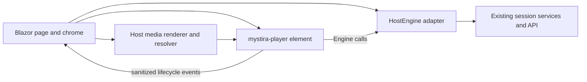

# Design: Legacy Story Compatibility

## Scope and authority

Spec 5 follows the four Kiroween specs. It extends their `Engine`/`Step` contract for old-story playback, then embeds the same player in Blazor. It does not move account, inventory, journal, AI guide, or awards state into this public package. The current Blazor game-session services remain authoritative during migration.



## Compatibility input

The source-level coverage inventory is in [source-audit.md](source-audit.md). It does not replace the fixture-backed matrix required before migration.

Keep Mystira story YAML as the authored format. Add a host adapter for the old app's scene/session DTOs; do not make the player parse a private Blazor DTO directly. Normalize `narrative`, `choice`, `roll`, `special`, the app-domain scene names, and numeric wire values through an explicit, tested mapping table. Preserve the original value in diagnostics. An unmapped or behaviorally distinct value produces `unsupported`; it never silently becomes `continue`.

Use the old app's `GameSessionService` and `GameFlowService` through a narrow Blazor JS-interop bridge first; an authorized API transport may later implement the same adapter contract. The element sees only `Engine` methods and validated `Step` values. Keep bearer tokens and account IDs out of the element. A host-owned media resolver maps protected and content-relative asset references before returning a step. The adapter retains the exact branch object, compass axis/direction/delta and verified displayed index for `HandleChoiceAsync`; sanitized element events never carry those values.

Initial cases to verify against the integration branch:

| Old surface | Proposed player handling | Evidence to capture |
|---|---|---|
| Narrative and choice scenes | Existing scene and choice interactions | Branch destinations, final-scene behavior |
| Roll scenes | New legacy roll interaction | Target, returned value, outcome branches, remount |
| Special scenes | Direct scene or host-stage extension after classification | Effects, completion, media |
| `stage3d` and `model3d` | Host-stage extension inside the player box | Poster, focus, URL/CORS, cleanup |
| App-domain and numeric scene types | Explicit DTO normalization | Raw type and behavior-preserving mapping |
| Character assignments and AI turns | Host session and AI player service; scene speaker/portrait in player | Profile/guest/AI attribution, disabled human input on AI turn |
| Narration, media and audio cues | Player text/timing controls with host audio orchestration | Word seek/highlight, ducking, unlock, SFX, volume and cleanup |
| Rewind | Unavailable until host checkpoint API exists | Current page handler is a no-op; `canGoBack=false` |
| Completion and awards | Player terminal state; host finalization and awards route | One completion/finalization, guest and age eligibility |

## Roll protocol

Add `roll` as a legacy capability, separate from the four contest interaction types. Proposed runtime shape:

```ts
type RollInteraction = {
  type: 'roll';
  target?: number;
  state: 'ready' | 'resolved';
  result?: { value: number; success: boolean; message: string };
};
type RollAnswer = { kind: 'roll' };
```

1. A ready step shows the target and Roll control. The player submits `RollAnswer` with one stable `answerRequestId` and disables a second roll while pending.
2. The host engine performs or reproduces the existing roll computation and returns the **same scene ID** in a resolved step with a higher version. It records the result in host session state. The player animates to the returned value; reduced motion shows it immediately. It does not derive `success` locally.
3. Continue sends `{ kind: 'continue' }`. The host engine applies the old success/failure branch rules, including the no-forward-path completion case, and returns the next step or terminal state.
4. A repeated request ID returns the same resolved step. Resume after remount returns the resolved state without rerolling.

Story completion needs a distinct terminal node or an explicit completed-step state; the assessment `result` node is score-specific and must not be reused as a generic ending. The terminal representation must have no active Next action, allow the host's end CTA, and emit `mp-complete` once per completed session. Continue on a ready roll is rejected until the roll resolves.

The current Blazor page computes a roll outcome and passes a boolean to `ContinueFromRollAsync`; the adapter must preserve that behavior initially while moving the player-facing decision behind `Engine`. Whether the long-term RNG moves to the server is a separate backend decision.

## Special and 3D extension

Inventory actual `special`, `stage3d`, and `model3d` fixtures first. A special scene that uses ordinary media and Continue can normalize to a scene node only after its distinct effects and completion behavior are accounted for. For a scene requiring host-specific rendering, use a named scene-stage extension owned by Blazor within the player's bounded 16:9 stage. The player retains dialogue, navigation, loading/error state, focus, and audio lifecycle. The host extension receives a validated presentation descriptor and resolves its own assets; it cannot select the next scene. Missing extensions produce a recoverable unsupported state and event.

## Host responsibilities and events

Blazor keeps the header, pause/resume and exit confirmation, AI guide, inventory/journal/roll rail, music and text settings, awards, account/profile controls, auth, and telemetry. `mp-node-enter`, `mp-answer`, `mp-complete`, `mp-unsupported-node`, and `mp-error` are integration signals; the host reads authoritative session state from its services. Keep `mp-answer` free of answer values. The host supplies theme tokens, `music="host"`, and notes visibility. The element changes no host route or history.

The host selects and assigns profile, guest and AI players before start. Its existing AI player service remains responsible for AI turns; the adapter gates human actions while it acts and resumes from the authoritative scene. The player receives only presentation-safe character identity and turn state. The host also retains the empty-session page, transition/loading state, exit confirmation and navigation lock. `mp-complete` triggers host completion/finalization once, then existing awards routing; it is not itself proof that badges were awarded.

Audio has one owner per channel. Blazor's `SceneAudioOrchestrator` owns background music, scene cues, media-action coordination and narration when the legacy audio path is active. The player renders Markdown and word timing/highlight controls and delegates play, stop and seek to a host audio bridge in that mode. If player-owned narration is selected later, host narration is disabled for that scene and the same stop-on-transition contract applies. Host settings supply volume, text size, narration preference and mute state. The bridge handles first-gesture unlock and must not replay a clip on remount.

## Compatibility matrix and gates

The matrix records each old capability, fixture, mapping, expected result, implementation owner, and test. Use non-sensitive fixtures from `mystira-workspace/apps/story-generator/test-data` plus sanitized API snapshots that exercise numeric scene types and session state. Compare old and new paths on IDs, branch destinations, rolls, player attribution, choice index/compass, pause/resume, completion/finalization, media, narration timing and accessibility. Record current Rewind as unavailable. Test a real Blazor harness with mount/unmount/remount and signed-in acceptance before switching the host flag. Do not label the player fully backward compatible until this gate passes.

## Risks to resolve during implementation

- Existing authored roll routes may have missing branches or self-loops; preserve the old defensive completion rule and test it.
- Some legacy scene types are app-domain names or numeric values rather than the four StoryGenerator names. Keep raw-type evidence and avoid lossy fallback.
- A 3D host renderer must respect the player's stage bounds and cleanup contract; a poster alone is a fallback, not equivalent 3D playback.
- Client-side roll computation matches today's app but does not make server scoring authoritative. Keep that distinction explicit in the matrix.
