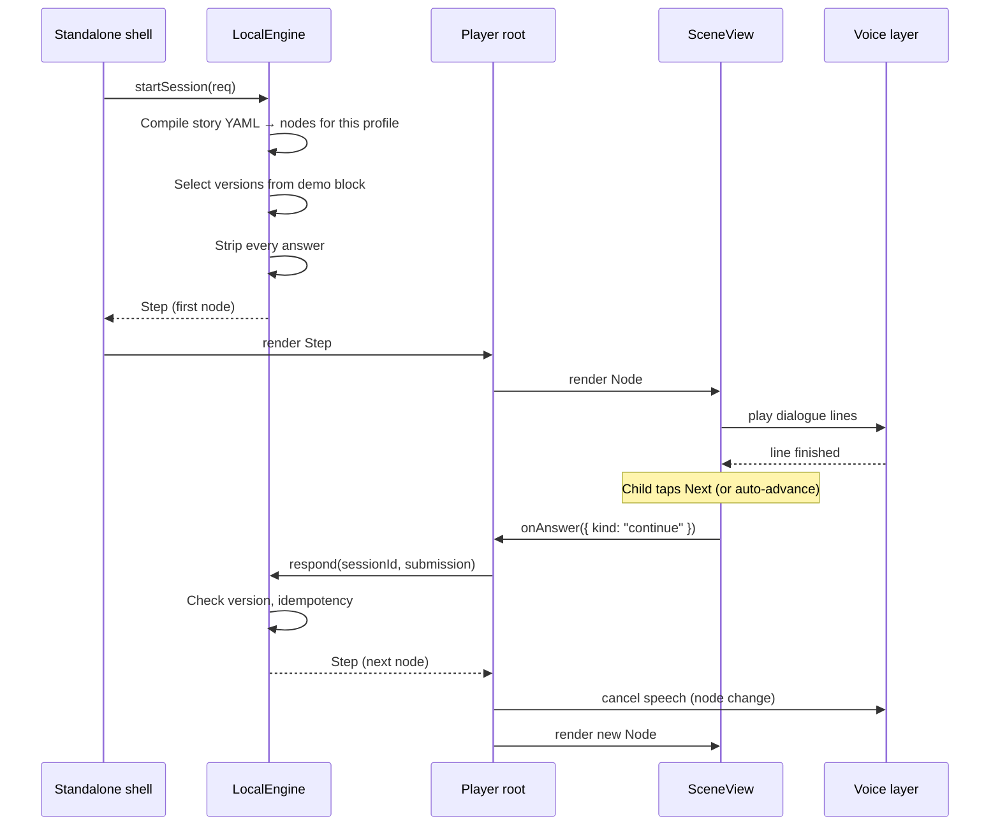
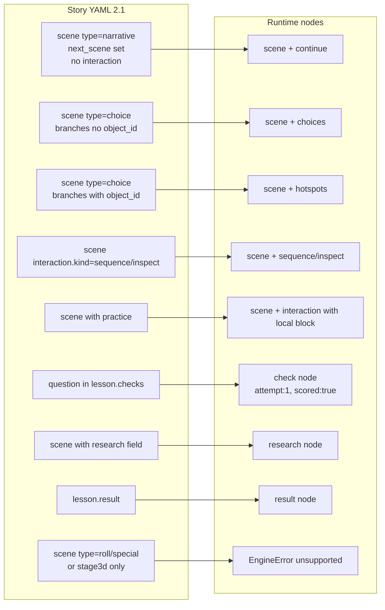
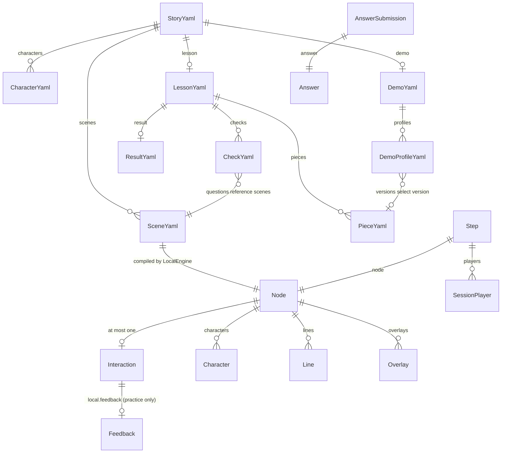

# Design Document: player-core

## Overview

This spec builds the foundation of the Mystira Player. It is the first of four specs; the later three add the four core interaction types (choices, hotspots, sequence, inspect) on top of this core. This spec ships no interaction type beyond `continue` (the Next button), but it builds the full shared mode machinery (open, practice, check), the feedback ladder, `revealAfter`, and the check confirmation flow as infrastructure that later specs exercise.

### What this spec delivers

- **Project scaffold**: Vite + React 19 + TypeScript strict + pnpm + Vitest, booting into the existing `index.html`.
- **Zod schemas**: runtime node schema (`src/schema/node.ts`) and story YAML 2.1 schema (`src/schema/story-yaml.ts`), mirroring `schema/story-schema-2.1.json`.
- **Engine interface**: `src/engine/types.ts`, exactly as in tech-spec section 5.
- **LocalEngine**: compiles `content/manor/pumpkin-gate.story.yaml` into nodes per tech-spec section 7, reads the `demo` block for per-child versions and order, strips every `answer`, and enforces session control rules.
- **Scene renderer**: media stage (16:9 box, video), characters (3 slots, reactions), dialogue (recorded audio or speech synthesis fallback, replay), overlays (backing plate, WCAG AA), task line, cross-fade transitions.
- **Next button and Back control**: `continue` interaction, keyboard-operable, density-compliant.
- **Shared mode machinery**: open/practice/check classification, feedback ladder, `revealAfter`, check confirmation ("That's my answer").
- **Notes panel**, **density**, **audio lifecycle**, **demo controls**, **Manor theme**.
- **Configurable auto-advance** (Requirement 21): a new per-scene content field that lets a `continue` scene advance automatically after dialogue audio finishes.

### Mental model

- **Engine decides, player renders.** The renderer sees only the `Engine` interface. Anything that chooses a version, order, or correctness for a child belongs to an engine. No component branches on a child's identity.
- **One content format.** Content is Mystira story YAML 2.1. Nodes are the runtime shape `LocalEngine` compiles the YAML into.
- **Identifiers are `profileId`, `playerId` and `sessionId`.** There is no `childId`.
- **Required 2.0 fields stay required.** The schemas reject content that drops them.
- **Scope cap.** Four core interactions across all specs. This spec ships only `continue`.

### Relationship to later specs

| Spec | Adds |
|---|---|
| player-core (this one) | scaffold, schemas, engine, renderer, mode machinery, `continue` |
| choices-hotspots | `choices` and `hotspots` interaction types |
| sequence | `sequence` interaction type |
| inspect | `inspect` interaction type |

The node schema defines all interaction types from the start (so the type system is complete), but `interactions.enabled` in `config.json` gates which types are allowed. For this spec, `interactions.enabled` is empty; only `continue` (always available as navigation) is rendered.

## Architecture

### Layer separation

```mermaid
flowchart TD
  subgraph Content["Content (static)"]
    YAML["content/manor/*.story.yaml"]
    JSON["schema/story-schema-2.1.json"]
  end

  subgraph SchemaLayer["Schema layer (src/schema/)"]
    NodeSchema["node.ts — Zod runtime node schema"]
    StorySchema["story-yaml.ts — Zod story YAML 2.1 schema"]
  end

  subgraph EngineLayer["Engine layer (src/engine/)"]
    EngineInt{{"Engine interface (types.ts)"}}
    Local["LocalEngine (local/) — compiles YAML → nodes, reads demo block"]
  end

  subgraph PlayerLayer["Player layer (src/player/)"]
    Player["Player root — manages session, submits answers"]
    SceneView["SceneView — renders one node"]
    Sub components["MediaStage, Dialogue, Characters, Overlay, NotesPanel, EndView, ErrorView"]
  end

  subgraph InteractionLayer["Interaction layer (src/interactions/shared/)"]
    Modes["modes.ts — open/practice/check"]
    Feedback["feedbackLadder.ts — practice feedback, revealAfter"]
    CheckConf["CheckConfirmation — That's my answer"]
  end

  subgraph VoiceLayer["Voice layer (src/voice/)"]
    Narration["NarrationPlayer — recorded audio"]
    Speech["SpeechVoice — speechSynthesis"]
    Tones["Tones — Web Audio feedback"]
  end

  subgraph ThemeLayer["Theme layer (src/theme/)"]
    Density["density.ts — age-group targets"]
    Tokens["tokens.ts — CSS custom properties"]
    Manor["themes/manor.ts — Manor palette"]
  end

  subgraph AppLayer["App layer (src/app/)"]
    Shell["Standalone shell — providers, routing"]
    Demo["DemoControls — child/day/notes switches"]
  end

  YAML --> StorySchema
  JSON -.validated against.-> StorySchema
  StorySchema --> Local
  NodeSchema -.validates output.-> Local
  Local -.implements.-> EngineInt
  EngineInt -.used by.-> Player
  Player --> SceneView
  SceneView --> Sub components
  SceneView --> InteractionLayer
  SceneView --> VoiceLayer
  SceneView -.styled by.-> ThemeLayer
  Shell --> Player
  Shell --> Demo
```

The renderer talks only to the `Engine` interface. It never knows which engine it has, never reads content graphs, and never works out a child's version of a piece. `LocalEngine` is the only place that reads the `demo` block.

### Data flow



### Node compilation flow



## Components and Interfaces

### File map

The project follows `.kiro/steering/structure.md`. Files created by this spec:

```
src/
  main.tsx                    Vite entry — renders App into #root
  app/
    App.tsx                   Standalone shell root
    providers.tsx             Engine, Config, Theme context providers
    routes.tsx               TanStack Router route definitions
    DemoControls.tsx          Child/day/notes switches (local demo only)
    config.ts                 Loads and validates public/config.json
  element/
    mystira-player.ts         <mystira-player> custom element (stub for this spec)
  engine/
    types.ts                  Engine interface (section 5)
    local/
      LocalEngine.ts          Engine implementation
      compiler.ts             Story YAML → node compilation
      session.ts              Session state, idempotency, version conflict
      demo-block.ts           Reads demo block for per-child versions/order
  schema/
    node.ts                   Zod runtime node schema
    interactions.ts           Zod interaction schemas (all types; enabled gates use)
    story-yaml.ts             Zod story YAML 2.1 schema
  player/
    Player.tsx                Root — session lifecycle, answer submission
    SceneView.tsx             Renders one scene/check/research/result node
    MediaStage.tsx            Image/video in 16:9 box
    Dialogue.tsx              Lines in order, audio/speech, replay
    Characters.tsx            3 slots, reactions on tap
    Overlay.tsx              Positioned text on backing plate
    TaskLine.tsx              Instruction line
    NotesPanel.tsx            Rationale for grown-up
    EndView.tsx               Result node rendering
    ErrorView.tsx             Error/unsupported screens
    useSession.ts             Session state hook
    useAutoAdvance.ts         Auto-advance hook
  interactions/
    shared/
      modes.ts                open/practice/check classification
      feedbackLadder.ts       Practice feedback selection
      CheckConfirmation.tsx   "That's my answer" flow
      usePracticeMode.ts       Practice state hook (wrong tries, reveal)
  voice/
    NarrationPlayer.ts        Recorded audio playback
    SpeechVoice.ts            speechSynthesis wrapper
    Tones.ts                  Web Audio feedback tones
    AudioLifecycle.ts         Cancel/stop/abort controller
  theme/
    tokens.ts                 CSS custom property definitions
    density.ts                Age-group tap target / text / narration defaults
    themes/
      manor.ts                Manor theme token set
      mystira-light.ts         Neutral light (stub)
      mystira-dark.ts          Neutral dark (stub)
      mystira-bright.ts        Neutral bright (stub)
  config.ts                   Runtime config type (mirrors config.json)
```

Tests sit next to the code (`*.test.ts(x)`).

### 1. Project scaffold (Requirement 1)

**Files**: `package.json`, `tsconfig.json`, `vite.config.ts`, `vitest.config.ts`, `src/main.tsx`, `public/config.json`

**package.json** key dependencies:
- `react@^19`, `react-dom@^19`
- `zod@^3` (validation)
- `@tanstack/react-router` (standalone routing)
- `oidc-client-ts` (auth — stubbed in this spec, local mode needs none)

Dev dependencies:
- `typescript@^5` (strict mode)
- `vite@^6`, `@vitejs/plugin-react`
- `vitest`, `@testing-library/react`, `@testing-library/jest-dom`, `jsdom`
- `fast-check` (property-based testing)

Scripts:
```json
{
  "dev": "vite",
  "build": "tsc -b && vite build",
  "preview": "vite preview",
  "test": "vitest --run",
  "test:watch": "vitest",
  "lint": "eslint src",
  "typecheck": "tsc --noEmit"
}
```

**tsconfig.json**: `strict: true`, `noUncheckedIndexedAccess: true`, `forceConsistentCasingInFileNames: true`, JSX automatic, moduleResolution `bundler`.

**vite.config.ts**: React plugin, path alias `@` → `src/`, server config. Vitest config embedded: `environment: jsdom`, `setupFiles: ["./src/test-setup.ts"]`, `globals: true`.

**src/main.tsx**: Imports `App`, creates root, renders `<App />` into `document.getElementById("root")`.

**index.html**: The existing file already has `<div id="root"></div>`. The scaffold adds the entry script tag:
```html
<script type="module" src="/src/main.tsx"></script>
```

**public/config.json** (runtime, not secret):
```json
{
  "mode": "local",
  "demo": true,
  "interactions": { "enabled": [] },
  "assetOrigins": [],
  "api": { "baseUrl": "" }
}
```

- `mode: "local"` — runs on `LocalEngine`, no network. (`"remote"` would use `RemoteEngine`; not in this spec.)
- `demo: true` — shows demo controls.
- `interactions.enabled` — list of enabled interaction types (beyond `continue`). Empty in this spec.
- `assetOrigins` — CSP `img-src`/`media-src` allowlist.
- `api.baseUrl` — player API base URL (empty in local mode).

### 2. Zod schemas (Requirements 2, 3)

#### `src/schema/node.ts` — Runtime node schema

All types are inferred from Zod schemas via `z.infer<>`. No hand-written parallel types.

**Shared parts**:

```typescript
// Region: 2D area within the 16:9 scene box, all values 0..1
export const RegionSchema = z.union([
  z.object({
    shape: z.literal("rect"),
    x: z.number().min(0).max(1),
    y: z.number().min(0).max(1),
    w: z.number().min(0).max(1),
    h: z.number().min(0).max(1),
  }),
  z.object({
    shape: z.literal("circle"),
    x: z.number().min(0).max(1),
    y: z.number().min(0).max(1),
    r: z.number().min(0).max(1),
  }),
]);

export const SpeakerSchema = z.object({
  id: z.string(),
  name: z.string(),
  avatarUrl: z.string().optional(),
  colour: z.string().regex(/^#[0-9A-Fa-f]{6}$/),
  voice: z.object({ pitch: z.number(), rate: z.number() }).optional(),
});

export const WordTimingSchema = z.object({
  word: z.string(),
  startMs: z.number(),
  endMs: z.number(),
});

export const LineSchema = z.object({
  speakerId: z.union([z.string(), z.literal("narrator")]),
  text: z.string(),
  audioUrl: z.string().optional(),
  wordTimings: z.array(WordTimingSchema).optional(),
});

export const NarrationSchema = z.object({
  text: z.string(),
  audioUrl: z.string().optional(),
  wordTimings: z.array(WordTimingSchema).optional(),
});

export const MediaSchema = z.object({
  imageUrl: z.string().optional(),
  alt: z.string().optional(),       // empty for decorative images
  video: z.object({
    url: z.string(),
    posterUrl: z.string().optional(),
    onEnd: z.enum(["advance", "stop"]),
    skippable: z.boolean(),
  }).optional(),
});

export const OverlaySchema = z.object({
  id: z.string(),
  text: z.string(),
  anchor: z.object({ x: z.number().min(0).max(1), y: z.number().min(0).max(1) }),
  align: z.enum(["start", "center", "end"]),
  style: z.enum(["caption", "callout", "label"]),
  maxWidth: z.number().optional(),
  narration: NarrationSchema.optional(),
});

export const RationaleSchema = z.object({
  differs: z.boolean(),
  text: z.string(),
});

export const CharacterSchema = z.object({
  id: z.string(),
  imageUrl: z.string(),
  alt: z.string(),
  position: z.enum(["left", "center", "right"]),
  pose: z.string().optional(),
  reactions: z.array(z.enum(["jump", "startle", "wave"])).optional(),
});
```

**SceneBase** — common fields for all node types that have a scene:

```typescript
const BaseSceneBaseSchema = z.object({
  id: z.string(),
  title: z.string().optional(),
  media: MediaSchema,
  characters: z.array(CharacterSchema),     // max 3, enforced by refine
  speakers: z.array(SpeakerSchema),
  lines: z.array(LineSchema),
  task: NarrationSchema.optional(),          // not on check nodes
  overlays: z.array(OverlaySchema),
  music: z.object({ profile: z.string() }).optional(),
  exitAllowed: z.boolean().optional(),
  rationale: RationaleSchema.optional(),
  slot: z.string().optional(),
  autoAdvance: z.boolean().optional(),       // NEW (Requirement 21)
});
```

**Feedback** (practice mode):

```typescript
export const FeedbackSchema = z.object({
  hint: NarrationSchema,
  onWrong: z.array(NarrationSchema).optional(),
  revealAfter: z.number().int().min(1).optional(),  // default 3
});
```

**Interactions** (defined in `src/schema/interactions.ts`, imported by `node.ts`):

```typescript
// All interaction types are defined for type completeness.
// interactions.enabled gates which are allowed at runtime.
export const ContinueInteractionSchema = z.object({
  type: z.literal("continue"),
  label: z.string().optional(),
  // autoAdvance lives on SceneBase, not here, so it applies
  // regardless of interaction type (see Requirement 21 design).
});

export const ChoicesInteractionSchema = z.object({
  type: z.literal("choices"),
  options: z.array(z.object({
    id: z.string(),
    label: z.string(),
    imageUrl: z.string().optional(),
    alt: z.string().optional(),
    icon: z.enum(["next", "retry", "look"]).optional(),
  })).min(2).max(4),
  local: z.object({
    correctId: z.string(),
    feedback: FeedbackSchema.optional(),
  }).optional(),
});

export const HotspotsInteractionSchema = z.object({
  type: z.literal("hotspots"),
  spots: z.array(z.object({
    id: z.string(),
    region: RegionSchema,
    label: z.string(),
    reveal: z.object({
      text: z.string(),
      imageUrl: z.string().optional(),
      alt: z.string().optional(),
    }).optional(),
  })).min(2).max(6),
  local: z.object({
    correctId: z.string(),
    feedback: FeedbackSchema.optional(),
  }).optional(),
});

export const SequenceInteractionSchema = z.object({
  type: z.literal("sequence"),
  items: z.array(z.object({
    id: z.string(),
    label: z.string(),
    imageUrl: z.string().optional(),
    alt: z.string().optional(),
  })).min(3).max(5),
  local: z.object({
    order: z.array(z.string()),
    feedback: FeedbackSchema.optional(),
  }).optional(),
});

export const InspectInteractionSchema = z.object({
  type: z.literal("inspect"),
  document: z.object({
    kind: z.enum(["message", "page", "sign"]),
    title: z.string(),
    parts: z.array(z.object({
      id: z.string(),
      role: z.enum(["sender", "heading", "text", "link", "button",
                     "image", "price", "footer"]),
      text: z.string(),
      imageUrl: z.string().optional(),
      alt: z.string().optional(),
    })).min(3).max(8),
  }),
  minMarks: z.number().int().min(0).optional(),  // default 1
  local: z.object({
    flagged: z.array(z.string()),
    feedback: FeedbackSchema.optional(),
  }).optional(),
});

// Stretch types (defined for completeness, not enabled in this spec):
export const PatternInteractionSchema = z.object({
  type: z.literal("pattern"),
  steps: z.array(z.object({
    id: z.string(), label: z.string(), icon: z.string().optional(), tone: z.number(),
  })).min(3).max(4),
  demo: z.array(z.string()).min(3).max(5),
  feedback: FeedbackSchema.optional(),
});

export const KeypadInteractionSchema = z.object({
  type: z.literal("keypad"),
  maxLength: z.number(),
  reference: z.string().optional(),
  showCall: z.boolean().optional(),
  local: z.object({
    value: z.string(),
    feedback: FeedbackSchema.optional(),
  }).optional(),
});

export const CountInteractionSchema = z.object({
  type: z.literal("count"),
  targets: z.array(z.object({
    id: z.string(), region: RegionSchema, label: z.string(),
  })).min(2).max(8),
  local: z.object({
    found: z.array(z.string()),
    feedback: FeedbackSchema.optional(),
  }).optional(),
});

export const InteractionSchema = z.discriminatedUnion("type", [
  ContinueInteractionSchema,
  ChoicesInteractionSchema,
  HotspotsInteractionSchema,
  SequenceInteractionSchema,
  InspectInteractionSchema,
  PatternInteractionSchema,
  KeypadInteractionSchema,
  CountInteractionSchema,
]);

export type Interaction = z.infer<typeof InteractionSchema>;
export type InteractionType = Interaction["type"];
```

**Node types** — discriminated union on `type`:

```typescript
export const SceneNodeSchema = z.object({
  type: z.literal("scene"),
  interaction: InteractionSchema,
}).merge(BaseSceneBaseSchema);

const BaseCheckNodeSchema = z.object({
  type: z.literal("check"),
  question: NarrationSchema,
  interaction: InteractionSchema,
  attempt: z.union([z.literal(1), z.literal(2)]),
  scored: z.boolean(),
})
  .merge(BaseSceneBaseSchema)
  .omit({ task: true })           // checks never have a task

export const ResearchNodeSchema = z.object({
  type: z.literal("research"),
  step: z.enum(["where", "find", "verify", "use"]),
  source: z.object({
    kind: z.enum(["character", "picture", "clip", "chart", "page"]),
    label: z.string(),
  }).optional(),
  yourAnswer: z.string().optional(),
  interaction: InteractionSchema,
}).merge(BaseSceneBaseSchema);

export const ResultNodeSchema = z.object({
  type: z.literal("result"),
  correctFirstTry: z.number().int(),
  total: z.number().int(),
  key: z.object({ label: z.string(), iconUrl: z.string() }).optional(),
  interaction: InteractionSchema,
}).merge(BaseSceneBaseSchema);

export const NodeSchema = z.discriminatedUnion("type", [
  SceneNodeSchema,
  CheckNodeSchema,
  ResearchNodeSchema,
  ResultNodeSchema,
]);

export type Node = z.infer<typeof NodeSchema>;
export type SceneNode = z.infer<typeof SceneNodeSchema>;
export type CheckNode = z.infer<typeof CheckNodeSchema>;
export type ResearchNode = z.infer<typeof ResearchNodeSchema>;
export type ResultNode = z.infer<typeof ResultNodeSchema>;
```

**Check node invariants** (Requirements 2.2, 2.3):

The `CheckNodeSchema` already omits `task`. Additional refinements enforce:

```typescript
// .superRefine() returns a NEW schema, it does not mutate the original.
// Chain both refinements and export the result.
export const CheckNodeSchema = BaseCheckNodeSchema
  .superRefine((node, ctx) => {
    // Requirement 2.2: check nodes reject local, task, and reveal
    const interaction = node.interaction as Record<string, unknown>;
    if ("local" in interaction && interaction.local !== undefined) {
      ctx.addIssue({
        code: z.ZodIssueCode.custom,
        path: ["interaction", "local"],
        message: "Check nodes must not carry a local block",
      });
    }
    if (interaction.type === "hotspots") {
      for (const spot of (interaction as { spots: { reveal?: unknown }[] }).spots) {
        if (spot.reveal !== undefined) {
          ctx.addIssue({
            code: z.ZodIssueCode.custom,
            path: ["interaction", "spots"],
            message: "Check nodes must not carry reveal",
          });
        }
      }
    }
  })
  .superRefine((node, ctx) => {
    // Requirement 2.3: attempt 2 implies scored: false
    if (node.attempt === 2 && node.scored === true) {
      ctx.addIssue({
        code: z.ZodIssueCode.custom,
        path: ["scored"],
        message: "A check at attempt 2 must not be scored",
      });
    }
  });
```

**Enabled-interaction gating** (Requirement 2.5):

The node schema is parameterized by the enabled interaction list. A factory function creates a schema that rejects disabled types:

```typescript
// src/schema/node.ts
export function createNodeValidator(enabled: InteractionType[]) {
  const alwaysAllowed = new Set(["continue"]); // navigation, not an interaction
  const allowed = new Set([...alwaysAllowed, ...enabled]);

  return NodeSchema.superRefine((node, ctx) => {
    const type = node.interaction.type;
    if (!allowed.has(type)) {
      ctx.addIssue({
        code: z.ZodIssueCode.custom,
        path: ["interaction", "type"],
        message: `unsupported`,  // the engine maps this to EngineError kind: unsupported
      });
    }
  });
}
```

The engine calls `createNodeValidator(config.interactions.enabled)` once at startup and validates every node it produces.

**Character slot uniqueness** (Requirement 9.5):

```typescript
// .superRefine() returns a NEW schema, it does not mutate the original.
export const SceneBaseSchema = BaseSceneBaseSchema.superRefine((base, ctx) => {
  const slots = new Map<string, string>(); // slot → character id
  for (const char of base.characters) {
    if (slots.has(char.position)) {
      ctx.addIssue({
        code: z.ZodIssueCode.custom,
        path: ["characters"],
        message: `Duplicate slot assignment: position '${char.position}' has characters '${slots.get(char.position)}' and '${char.id}'`,
      });
    }
    slots.set(char.position, char.id);
  }
  if (base.characters.length > 3) {
    ctx.addIssue({
      code: z.ZodIssueCode.custom,
      path: ["characters"],
      message: "A scene may have at most 3 characters",
    });
  }
});
```

#### `src/schema/story-yaml.ts` — Story YAML 2.1 schema

This Zod schema mirrors `schema/story-schema-2.1.json`. Engine fields are accepted as opaque values (`z.unknown()`), never validated or used.

**Design principle**: every field the JSON schema accepts is accepted here. Required 2.0 fields stay required. 2.1 additions are optional. The `auto_advance` field (Requirement 21) is added.

```typescript
// Story-level
export const StoryYamlSchema = z.object({
  schema_version: z.string().optional(),
  version: z.string().optional(),

  // Required 2.0 fields (stay required):
  title: z.string(),
  description: z.string(),
  image: z.string(),
  tags: z.array(z.string()),
  difficulty: z.enum(["Easy", "Medium", "Hard"]),
  session_length: z.enum(["Short", "Medium", "Long", "Very Long"]),
  age_group: z.enum(["1-2", "3-5", "6-9", "10-12", "13-18", "19+"]),
  minimum_age: z.number().int(),
  core_axes: z.unknown(),          // engine field, opaque
  archetypes: z.array(z.string()),
  characters: z.array(CharacterYamlSchema),
  scenes: z.array(SceneYamlSchema),

  // Optional fields:
  music_palette: z.unknown().optional(),   // engine/host field

  // 2.1 additions:
  lesson: LessonYamlSchema.optional(),
  demo: DemoYamlSchema.optional(),
});

// Character
export const CharacterYamlSchema = z.object({
  id: z.string(),
  name: z.string(),
  image: z.union([z.string(), z.null()]),
  audio: z.union([z.string(), z.null()]),
  metadata: z.unknown(),           // required by importer, opaque to player
  voice: z.object({ pitch: z.number(), rate: z.number() }).optional(),
  colour: z.string().optional(),
});

// Scene — required 2.0 fields stay required, 2.1 additions optional
export const SceneYamlSchema = z.object({
  // Required 2.0:
  id: z.string(),
  title: z.string(),
  type: z.enum(["narrative", "choice", "roll", "special"]),
  active_character: z.union([z.string(), z.null()]),
  description: z.string(),
  next_scene: z.union([z.string(), z.null()]),
  difficulty: z.unknown(),          // engine field, may be null
  media: z.object({
    image: z.union([z.string(), z.null()]),
    audio: z.union([z.string(), z.null()]),
    video: z.union([z.string(), z.null()]),
    stage3d: z.unknown().optional(),
    model3d: z.unknown().optional(),
    timestamps: z.array(z.object({
      word: z.string(), startMs: z.number(), endMs: z.number(),
      charStart: z.number().int().nullable().optional(),
      charEnd: z.number().int().nullable().optional(),
    })).nullable().optional(),
    alignment: z.unknown().optional(),
  }),
  branches: z.array(z.object({
    choice: z.string(),
    next_scene: z.union([z.string(), z.null()]),
    id: z.union([z.string(), z.null()]).optional(),
    object_id: z.union([z.string(), z.null()]).optional(),
    verb: z.union([z.string(), z.null()]).optional(),
    image: z.union([z.string(), z.null()]).optional(),
    // engine fields accepted as opaque:
    action_id: z.unknown().optional(),
    target_object_id: z.unknown().optional(),
    skill_tag: z.unknown().optional(),
    difficulty: z.unknown().optional(),
    risk: z.unknown().optional(),
    requirements: z.unknown().optional(),
    modifier_sources: z.unknown().optional(),
    modifier_preview: z.unknown().optional(),
    effects: z.unknown().optional(),
    success_next_scene: z.unknown().optional(),
    success_rewind_policy: z.unknown().optional(),
    success_effects: z.unknown().optional(),
    failure_next_scene: z.unknown().optional(),
    failure_rewind_policy: z.unknown().optional(),
    failure_effects: z.unknown().optional(),
    rewind_policy: z.unknown().optional(),
    echo_log: z.unknown().optional(),
    compass_change: z.unknown().optional(),
  })),
  metadata: z.unknown(),          // required by importer, opaque

  // 2.1 additions (optional):
  lines: z.array(z.object({
    speaker: z.string(),
    text: z.string(),
    audio: z.union([z.string(), z.null()]).optional(),
  })).optional(),
  task: z.object({ text: z.string(), audio: z.union([z.string(), z.null()]).optional() }).optional(),
  cast: z.array(z.object({
    character_id: z.string(),
    slot: z.enum(["left", "center", "right"]),
    pose: z.union([z.string(), z.null()]).optional(),
    reactions: z.array(z.enum(["jump", "startle", "wave"])).optional(),
  })).max(3).optional(),
  overlays: z.array(z.object({
    id: z.string(),
    text: z.string(),
    x: z.number().min(0).max(1),
    y: z.number().min(0).max(1),
    align: z.enum(["start", "center", "end"]).optional(),
    style: z.enum(["caption", "callout", "label"]).optional(),
    max_width: z.number().min(0).max(1).optional(),
  })).optional(),
  objects: z.array(z.object({
    id: z.string(),
    label: z.string().optional(),
    name: z.string().optional(),
    description: z.union([z.string(), z.null()]).optional(),
    type: z.string().optional(),
    geometry: z.object({
      anchor: z.union([z.string(), z.null()]).optional(),
      bounds: z.array(z.number()).nullable().optional(),
      position_offset: z.array(z.number()).nullable().optional(),
      scale: z.union([z.number(), z.null()]).optional(),
      facing: z.union([z.string(), z.null()]).optional(),
      rotation_y_deg: z.union([z.number(), z.null()]).optional(),
    }).nullable().optional(),
    reveal: z.object({
      text: z.string(),
      image: z.union([z.string(), z.null()]).optional(),
    }).optional(),
    // engine fields:
    state: z.unknown().optional(),
    action_ids: z.unknown().optional(),
    position: z.unknown().optional(),
    interactions: z.unknown().optional(),
  })).optional(),
  interaction: z.union([
    z.object({
      kind: z.literal("sequence"),
      items: z.array(z.object({
        id: z.string(), label: z.string(),
        image: z.union([z.string(), z.null()]).optional(),
      })).min(3).max(5),
    }),
    z.object({
      kind: z.literal("inspect"),
      min_marks: z.number().int().min(0).optional(),
      document: z.object({
        kind: z.enum(["message", "page", "sign"]),
        title: z.string(),
        parts: z.array(z.object({
          id: z.string(),
          role: z.enum(["sender", "heading", "text", "link", "button",
                         "image", "price", "footer"]),
          text: z.string(),
          image: z.union([z.string(), z.null()]).optional(),
        })).min(3).max(8),
      }),
    }),
  ]).optional(),
  practice: z.object({
    answer: z.object({
      branch: z.string().optional(),
      object: z.string().optional(),
      order: z.array(z.string()).min(3).max(5).optional(),
      parts: z.array(z.string()).optional(),
    }),
    hint: z.object({
      text: z.string(),
      audio: z.union([z.string(), z.null()]).optional(),
    }).optional(),
    on_wrong: z.array(z.object({
      text: z.string(),
      audio: z.union([z.string(), z.null()]).optional(),
    })).optional(),
    reveal_after: z.number().int().min(1).max(5).optional(),
  }).optional(),
  research: z.object({
    step: z.enum(["where", "find", "verify", "use"]),
    source: z.object({
      kind: z.enum(["character", "picture", "clip", "chart", "page"]),
      label: z.string(),
    }).optional(),
  }).optional(),
  exit_allowed: z.boolean().optional(),
  host_slot: z.union([z.string(), z.null()]).optional(),
  auto_advance: z.boolean().optional(),     // NEW (Requirement 21)

  // Engine fields accepted as opaque:
  act_id: z.unknown().optional(),
  scene_objects: z.unknown().optional(),
  choice_structure: z.unknown().optional(),
  scored_axes: z.unknown().optional(),
  path_type: z.unknown().optional(),
  roll_routes: z.unknown().optional(),
  next_scene_rewind_policy: z.unknown().optional(),
  rewind_policy: z.unknown().optional(),
  narration_timestamps: z.array(z.object({
    word: z.string(), startMs: z.number(), endMs: z.number(),
    charStart: z.number().int().nullable().optional(),
    charEnd: z.number().int().nullable().optional(),
  })).nullable().optional(),
  music: z.object({
    profile: z.enum(["none","neutral","cozy","playful","wonder","mystery","tense","action","sad","victory"]),
    continuity: z.enum(["none","prefer_continue","allow_change","force_change","force_silence"]),
    priority: z.enum(["none","background","important"]).optional(),
    transition_hint: z.enum(["none","auto","keep","crossfade_short","crossfade_normal","crossfade_long","hard_cut"]).optional(),
    energy: z.number().min(0).max(1).optional(),
    ducking: z.enum(["none","narration","dialogue"]).optional(),
  }).optional(),
  sound_effects: z.unknown().optional(),
  echo_reveals: z.unknown().optional(),
});

// Lesson block
export const LessonYamlSchema = z.object({
  id: z.string(),
  title: z.string(),
  pieces: z.array(z.object({
    id: z.string(),
    title: z.string(),
    scenes: z.array(z.string()).min(1).optional(),
    versions: z.array(z.object({
      id: z.string(),
      scenes: z.array(z.string()).min(1),
      method: z.string().optional(),
    })).min(2).optional(),
  })).min(1),
  checks: z.array(z.object({
    id: z.string(),
    title: z.string().optional(),
    questions: z.array(z.object({
      id: z.string(),
      scene: z.string(),
      answer: z.object({
        branch: z.string().optional(),
        object: z.string().optional(),
        order: z.array(z.string()).min(3).max(5).optional(),
        parts: z.array(z.string()).optional(),
      }),
      research: z.array(z.string()).optional(),
    })).min(1),
  })).optional(),
  result: z.object({
    scene: z.string(),
    key: z.object({
      label: z.string(),
      image: z.union([z.string(), z.null()]).optional(),
    }).optional(),
  }).optional(),
}).superRefine((data, ctx) => {
  // Each piece has either scenes or versions, never both:
  for (const piece of data.pieces) {
    if (piece.scenes && piece.versions) {
      ctx.addIssue({
        code: z.ZodIssueCode.custom,
        path: ["pieces"],
        message: `Piece '${piece.id}' has both scenes and versions`,
      });
    }
    if (!piece.scenes && !piece.versions) {
      ctx.addIssue({
        code: z.ZodIssueCode.custom,
        path: ["pieces"],
        message: `Piece '${piece.id}' has neither scenes nor versions`,
      });
    }
  }
});

// Demo block
export const DemoYamlSchema = z.object({
  profiles: z.array(z.object({
    id: z.string(),
    display_name: z.string(),
    strengths: z.array(z.string()).optional(),
    versions: z.record(z.string(), z.string()).optional(),
    order: z.enum(["fixed", "child_chooses"]).optional(),
    rationale: z.record(z.string(), z.string()).optional(),
  })).min(1),
});

export type StoryYaml = z.infer<typeof StoryYamlSchema>;
export type SceneYaml = z.infer<typeof SceneYamlSchema>;
export type LessonYaml = z.infer<typeof LessonYamlSchema>;
export type DemoYaml = z.infer<typeof DemoYamlSchema>;
```

**Missing-field errors** (Requirement 3.3): Zod's default error messages include the path to the missing field. For clearer messages, a custom error map translates `invalid_type` errors for missing required fields to `"Missing required field: <field>"`.

**Round-trip support**: The schema uses `.passthrough()` is not needed because all fields are explicitly listed (engine fields as `z.unknown()`). Serialization uses `JSON.stringify` (Zod objects are plain objects after parse). For story YAML round-trip, parse → `JSON.stringify` → `JSON.parse` → parse yields an equivalent object.

### 3. Engine interface (Requirement 4)

**File**: `src/engine/types.ts`

Defined exactly as in tech-spec section 5. Types are exported for use by engines and the renderer.

```typescript
// src/engine/types.ts
export type AgeGroupId = "1-2" | "3-5" | "6-9" | "10-12" | "13-18" | "19+";

export type Profile = {
  profileId: string;
  displayName: string;
  avatarUrl?: string;
};

export type Region =
  | { shape: "rect"; x: number; y: number; w: number; h: number }
  | { shape: "circle"; x: number; y: number; r: number };

export type Speaker = {
  id: string; name: string; avatarUrl?: string; colour: string;
  voice?: { pitch: number; rate: number };
};

export type Line = {
  speakerId: string | "narrator"; text: string; audioUrl?: string;
  wordTimings?: { word: string; startMs: number; endMs: number }[];
};

export type Narration = {
  text: string; audioUrl?: string;
  wordTimings?: { word: string; startMs: number; endMs: number }[];
};

export type Media = {
  imageUrl?: string; alt?: string;
  video?: { url: string; posterUrl?: string; onEnd: "advance" | "stop"; skippable: boolean };
};

export type Overlay = {
  id: string; text: string; anchor: { x: number; y: number };
  align: "start" | "center" | "end"; style: "caption" | "callout" | "label";
  maxWidth?: number; narration?: Narration;
};

export type Rationale = { differs: boolean; text: string };

export type Character = {
  id: string; imageUrl: string; alt: string;
  position: "left" | "center" | "right"; pose?: string;
  reactions?: ("jump" | "startle" | "wave")[];
};

// Import Node type from schema (inferred from Zod)
import type { Node } from "../schema/node";

export type Answer =
  | { kind: "continue" }
  | { kind: "back" }
  | { kind: "choice"; choiceId: string }
  | { kind: "hotspot"; hotspotId: string }
  | { kind: "sequence"; itemIds: string[] }
  | { kind: "inspect"; partIds: string[] }
  // stretch:
  | { kind: "pattern"; stepIds: string[] }
  | { kind: "keypad"; value: string }
  | { kind: "count"; targetIds: string[] };

export type AnswerSubmission = {
  answerRequestId: string;
  version: string;
  nodeId: string;
  answer: Answer;
  wrongTries?: number;
  playerId?: string;
};

export type EngineError = {
  kind: "network" | "auth" | "notFound" | "conflict" | "unsupported" | "server";
  message?: string;
  currentStep?: Step;   // present on conflict: the engine carries the current Step
};

export type SessionPlayer = {
  playerId: string;
  type: "Profile" | "Guest";
  profileId?: string;
  displayName: string;
  avatarUrl?: string;
};

export type Step = {
  sessionId: string;
  version: string;
  ageGroupId: AgeGroupId;
  players: SessionPlayer[];
  activePlayerId?: string;
  node: Node;
  canGoBack?: boolean;
  progress?: { done: number; total: number };
  prefetch?: string[];
};

export type PlayerSeat =
  | { type: "Profile"; profileId: string }
  | { type: "Guest"; displayName: string };

export type StartSessionRequest = {
  activityId: string;
  players: PlayerSeat[];
  startNodeId?: string;
};

export type ActivityCard = {
  activityId: string;
  kind: "story" | "lesson" | "check";
  title: string;
  imageUrl: string;
  ageGroupId: AgeGroupId;
  state: "locked" | "open" | "solved";
  pending: boolean;
  resumeSessionId?: string;
  narration?: Narration;
};

export type Hub = {
  background: { imageUrl: string; alt: string };
  narration?: Narration;
  doors: { activityId: string; region: Region; label: string }[];
  keys?: { activityId: string; label: string; iconUrl: string }[];
};

export type Home = {
  activities: ActivityCard[];
  hub?: Hub;
};

export interface Engine {
  listProfiles?(): Promise<Profile[]>;
  getHome?(profileId: string): Promise<Home>;
  startSession(req: StartSessionRequest): Promise<Step>;
  resumeSession(sessionId: string): Promise<Step>;
  respond(sessionId: string, r: AnswerSubmission): Promise<Step>;
}
```

**Design note**: The `Node` type is inferred from the Zod schema in `src/schema/node.ts` and imported here. This avoids a parallel type definition. The engine types reference `Node` but do not re-define it.

### 4. LocalEngine (Requirements 5, 6, 7, 8)

**Files**: `src/engine/local/LocalEngine.ts`, `compiler.ts`, `session.ts`, `demo-block.ts`

#### `LocalEngine.ts` — Engine implementation

Implements the `Engine` interface. In local mode, it:
1. Loads and validates the story YAML at construction time.
2. On `startSession`, compiles the story into a node graph for the requested profile.
3. On `respond`, advances through the node graph, enforcing session rules.

```typescript
export class LocalEngine implements Engine {
  private story: StoryYaml;
  private sessions: Map<string, Session> = new Map();
  private nodeValidator: ReturnType<typeof createNodeValidator>;
  private checkAnswers: Map<string, CheckAnswer>; // sceneId → answer (engine-only)

  constructor(storyYaml: unknown, config: { interactions: { enabled: InteractionType[] } }) {
    this.story = StoryYamlSchema.parse(storyYaml);
    this.nodeValidator = createNodeValidator(config.interactions.enabled);
    this.checkAnswers = extractCheckAnswers(this.story); // see below
  }

  async listProfiles(): Promise<Profile[]> {
    // Returns demo profiles as Profile objects
    return (this.story.demo?.profiles ?? []).map(p => ({
      profileId: p.id,
      displayName: p.display_name,
    }));
  }

  async getHome(profileId: string): Promise<Home> {
    // Builds activity cards from the story + demo data
    // (Stub for this spec — the hub comes in a later task; returns activities list)
  }

  async startSession(req: StartSessionRequest): Promise<Step> {
    const profile = req.players.find(p => p.type === "Profile");
    const sessionId = crypto.randomUUID();
    const compiled = compileStory(this.story, profile?.profileId, this.checkAnswers, this.nodeValidator);
    const session: Session = {
      sessionId,
      version: "0",
      compiled,       // node graph + navigation
      current: compiled.entryNode,
      history: [],
      processedRequests: new Map(),  // answerRequestId → Step (idempotency)
    };
    this.sessions.set(sessionId, session);
    return this.buildStep(session);
  }

  async resumeSession(sessionId: string): Promise<Step> {
    const session = this.sessions.get(sessionId);
    if (!session) throw { kind: "notFound", message: "Session not found" } as EngineError;
    return this.buildStep(session);
  }

  async respond(sessionId: string, r: AnswerSubmission): Promise<Step> {
    const session = this.sessions.get(sessionId);
    if (!session) throw { kind: "notFound" } as EngineError;

    // Requirement 8.1: idempotency — repeated answerRequestId returns same Step
    if (session.processedRequests.has(r.answerRequestId)) {
      return session.processedRequests.get(r.answerRequestId)!;
    }

    // Requirement 8.2: stale version → conflict
    if (r.version !== session.version) {
      throw {
        kind: "conflict",
        currentStep: this.buildStep(session),
      } as EngineError;
    }

    // Requirement 8.3/8.4: back navigation
    if (r.answer.kind === "back") {
      if (!session.canGoBack) throw { kind: "conflict", currentStep: this.buildStep(session) } as EngineError;
      session.current = session.history.pop()!;
    } else {
      // Advance to next node
      session.history.push(session.current);
      session.current = session.compiled.next(session.current, r.answer);
    }

    session.version = String(Number(session.version) + 1);
    const step = this.buildStep(session);
    session.processedRequests.set(r.answerRequestId, step);
    return step;
  }
}
```

#### `compiler.ts` — Story YAML → node compilation

This is the core of Requirement 5. It transforms story YAML scenes into runtime nodes.

**Key compilation rules**:

| Story YAML scene | Compiled node |
|---|---|
| `type: narrative`, `next_scene` set, no `interaction` block | `scene` + `continue` interaction |
| `type: choice`, branches without `object_id` | `scene` + `choices` interaction |
| `type: choice`, branches with `object_id` | `scene` + `hotspots` interaction |
| `interaction.kind: sequence` | `scene` + `sequence` interaction |
| `interaction.kind: inspect` | `scene` + `inspect` interaction |
| `practice` block present | interaction gets `local` block (built from `practice`) |
| Scene listed in `lesson.checks` | `check` node, `attempt: 1`, `scored: true` |
| Scene with `research` field | `research` node |
| `lesson.result` | `result` node |
| `type: roll` or `special` | `EngineError { kind: "unsupported" }` |
| `stage3d` only (no image, no video, has stage3d) | `EngineError { kind: "unsupported" }` |
| No `lines` | `description` becomes single narrator line |

```typescript
// compiler.ts

interface CompiledStory {
  entryNodeId: string;
  nodes: Map<string, Node>;           // nodeId → Node
  next: (currentNodeId: string, answer: Answer) => string;  // → next nodeId
}

function compileStory(
  story: StoryYaml,
  profileId: string | undefined,
  checkAnswers: Map<string, CheckAnswer>,
  nodeValidator: ReturnType<typeof createNodeValidator>,
): CompiledStory {
  // 1. Determine piece order and version selection from demo block
  const demoSelection = selectFromDemoBlock(story, profileId);

  // 2. Build scene id → scene lookup
  const scenesById = new Map(story.scenes.map(s => [s.id, s]));

  // 3. Identify check scenes (from lesson.checks)
  const checkSceneIds = new Set(
    story.lesson?.checks?.flatMap(c => c.questions.map(q => q.scene)) ?? []
  );

  // 4. Compile each scene into a node
  const nodes = new Map<string, Node>();
  for (const scene of story.scenes) {
    if (scene.type === "roll" || scene.type === "special") {
      // Requirement 5.4: raise unsupported
      // The node is not added; the engine handles this at navigation time
      continue; // marked as unsupported in the navigation map
    }
    if (isStage3dOnly(scene)) {
      continue; // unsupported
    }

    const node = checkSceneIds.has(scene.id)
      ? compileCheckScene(scene, story, checkAnswers)
      : scene.research
        ? compileResearchScene(scene, story)
        : compileScene(scene, story);

    // Requirement 7.1: strip every answer before building the node
    // (compileScene/compileCheckScene already exclude answer fields)
    // Requirement 7.2: validate the node carries no answer
    assertNoAnswerOnNode(node);

    // Requirement 2.5: validate against enabled interactions
    const result = nodeValidator.safeParse(node);
    if (!result.success) {
      // If the issue is "unsupported", mark this scene as unsupported
      // Otherwise, throw (content is invalid)
    }

    nodes.set(scene.id, node);
  }

  // 5. Compile result node (if lesson.result exists)
  if (story.lesson?.result) {
    const resultScene = scenesById.get(story.lesson.result.scene);
    if (resultScene) {
      const resultNode = compileResultScene(resultScene, story.lesson.result);
      nodes.set(resultScene.id, resultNode);
    }
  }

  // 6. Build navigation function
  const next = buildNavigation(story, demoSelection, checkAnswers);

  // 7. Determine entry node (first scene of first piece, or first scene)
  const entryNode = demoSelection.order[0] ?? story.scenes[0]?.id;

  return { entryNodeId: entryNode, nodes, next };
}
```

**Scene compilation** (`compileScene`):

```typescript
function compileScene(scene: SceneYaml, story: StoryYaml): Node {
  const characters = buildCharacters(scene, story);
  const speakers = buildSpeakers(scene, story);
  const lines = buildLines(scene);  // Requirement 5.2: no lines → description as narrator line
  const interaction = buildInteraction(scene);
  const media = buildMedia(scene);
  const overlays = buildOverlays(scene);
  const music = scene.music ? { profile: scene.music.profile } : undefined;

  return {
    type: "scene",
    id: scene.id,
    title: scene.title,
    media,
    characters,
    speakers,
    lines,
    task: scene.task ? buildNarration(scene.task) : undefined,
    overlays,
    music,
    exitAllowed: scene.exit_allowed,
    rationale: undefined,  // attached by demo-block selection
    slot: scene.host_slot ?? undefined,
    autoAdvance: scene.auto_advance ?? false,  // Requirement 21
    interaction,
  };
}
```

**Requirement 5.2 — no `lines` → description as narrator line**:

```typescript
function buildLines(scene: SceneYaml): Line[] {
  if (scene.lines && scene.lines.length > 0) {
    // Requirement 5.3: map lines, task, cast, overlays, media, music
    return scene.lines.map(l => ({
      speakerId: l.speaker,
      text: l.text,
      audioUrl: l.audio ?? undefined,
    }));
  }
  // Requirement 5.2: no lines → description as single narrator line
  return [{ speakerId: "narrator", text: scene.description }];
}
```

**Requirement 5.1 — narrative scene with `next_scene` and no interaction → `continue`**:

```typescript
function buildInteraction(scene: SceneYaml): Interaction {
  if (scene.interaction) {
    // Sequence or inspect interaction block
    return buildInteractionBlock(scene.interaction, scene.practice);
  }
  if (scene.type === "choice") {
    const hasObjectId = scene.branches.some(b => b.object_id);
    if (hasObjectId) {
      return buildHotspots(scene);  // later spec
    }
    return buildChoices(scene);     // later spec
  }
  // narrative with next_scene → continue (Requirement 5.1)
  return { type: "continue" };
}
```

**Requirement 5.5 — check scene → check node**:

```typescript
function compileCheckScene(
  scene: SceneYaml,
  story: StoryYaml,
  checkAnswers: Map<string, CheckAnswer>,
): Node {
  // Check answers are kept in the engine, never on the node (Requirement 7.1)
  const interaction = buildInteraction(scene);
  // Requirement 2.2: check nodes must not carry local, task, or reveal
  // The interaction must not have a local block:
  if ("local" in interaction) {
    delete (interaction as any).local;
  }

  return {
    type: "check",
    id: scene.id,
    title: scene.title,
    question: buildNarration({ text: scene.description }),
    interaction,
    attempt: 1,         // Requirement 5.5
    scored: true,
    media: buildMedia(scene),
    characters: buildCharacters(scene, story),
    speakers: buildSpeakers(scene, story),
    lines: buildLines(scene),
    overlays: buildOverlays(scene),
    // task is omitted (check nodes never have task)
    music: scene.music ? { profile: scene.music.profile } : undefined,
    rationale: undefined,
    autoAdvance: scene.auto_advance ?? false,
  };
}
```

**Requirement 5.6 — research scene → research node**:

```typescript
function compileResearchScene(scene: SceneYaml, story: StoryYaml): Node {
  return {
    type: "research",
    step: scene.research!.step,
    source: scene.research!.source,
    yourAnswer: undefined,  // filled in by engine after a wrong check answer
    interaction: buildInteraction(scene),
    // ... SceneBase fields (same as compileScene)
  };
}
```

**Requirement 5.7 — `lesson.result` → result node**:

```typescript
function compileResultScene(scene: SceneYaml, result: LessonYaml["result"]): Node {
  return {
    type: "result",
    correctFirstTry: 0,  // filled by engine from check results
    total: 0,            // filled by engine
    key: result?.key ? {
      label: result.key.label,
      iconUrl: result.key.image ?? "",
    } : undefined,
    interaction: { type: "continue" },
    // ... SceneBase fields
  };
}
```

#### `demo-block.ts` — Per-child version selection (Requirement 6)

```typescript
interface DemoSelection {
  profileId: string;
  // pieceId → versionId (for versioned pieces)
  versions: Map<string, string>;
  // ordered list of entry scene ids (one per piece, in the chosen order)
  order: string[];
  // pieceId → rationale (from demo block)
  rationales: Map<string, Rationale>;
}

function selectFromDemoBlock(story: StoryYaml, profileId?: string): DemoSelection {
  const demo = story.demo;
  const lesson = story.lesson;
  if (!demo || !lesson || !profileId) {
    // No demo block: all pieces in lesson order, no per-child versions
    return defaultSelection(story);
  }

  const profile = demo.profiles.find(p => p.id === profileId);
  if (!profile) return defaultSelection(story);

  // Requirement 6.1: read demo block for version and order
  const versions = new Map<string, string>(Object.entries(profile.versions ?? {}));

  // Requirement 6.3/6.4: order
  const pieces = lesson.pieces;
  let orderedPieceIds: string[];
  if (profile.order === "child_chooses") {
    // Requirement 6.4: child chooses order
    // The engine presents pieces in lesson order; the child's choices
    // determine the actual order at runtime (via choices interaction).
    // For this spec (continue only), we present in lesson order and
    // the child_chooses flag is stored for later specs.
    orderedPieceIds = pieces.map(p => p.id);
  } else {
    // Requirement 6.3: fixed → lesson order
    orderedPieceIds = pieces.map(p => p.id);
  }

  // Build entry scene for each piece (using the selected version)
  const order: string[] = [];
  const rationales = new Map<string, Rationale>();
  for (const pieceId of orderedPieceIds) {
    const piece = pieces.find(p => p.id === pieceId)!;
    let sceneId: string;
    if (piece.versions) {
      // Requirement 6.2: compile the version named for this profile
      const versionId = versions.get(pieceId);
      const version = piece.versions.find(v => v.id === versionId)
        ?? piece.versions[0];
      sceneId = version.scenes[0];
    } else {
      sceneId = piece.scenes![0];
    }
    order.push(sceneId);

    // Requirement 6.5: take rationale from demo block
    const rationaleText = profile.rationale?.[pieceId];
    if (rationaleText) {
      rationales.set(sceneId, {
        differs: piece.versions !== undefined,
        text: rationaleText,
      });
    }
  }

  return { profileId, versions, order, rationales };
}
```

The compiler attaches the rationale to each compiled node:

```typescript
// In compileStory, after compiling each scene:
const rationale = demoSelection.rationales.get(scene.id);
if (rationale) {
  node.rationale = rationale;
}
```

**Requirement 6.6**: No component branches on child identity. The `DemoSelection` is resolved entirely within `LocalEngine`. The renderer only sees the `Node` (with its `rationale` field) and the `Step`. There is no `childId` or profile reference in any component.

#### `session.ts` — Session state and control (Requirement 8)

```typescript
interface Session {
  sessionId: string;
  version: string;
  compiled: CompiledStory;
  current: string;              // current node id
  history: string[];            // node ids for back navigation
  canGoBack: boolean;           // computed from current node type
  processedRequests: Map<string, Step>;  // answerRequestId → Step
}
```

**Requirement 8.1 (idempotency)**: Before processing a `respond` call, check if `answerRequestId` is in `processedRequests`. If so, return the stored `Step` without re-processing.

**Requirement 8.2 (stale version)**: Compare `r.version` with `session.version`. If they differ, throw `EngineError { kind: "conflict", currentStep: this.buildStep(session) }`.

**Requirement 8.3/8.4 (canGoBack)**: `canGoBack` is true when `session.history.length > 0` and the current node is not a check. `back` answers are rejected (throw conflict) when `canGoBack` is false.

**Requirement 8.5**: `canGoBack` is always false on check nodes.

**Requirement 8.6**: When a check is at `attempt: 2`, the engine produces a check node with `scored: false`. The `attempt` field on the node tells the renderer to show "This try does not count for the score".

#### Answer extraction and stripping (Requirement 7)

```typescript
// Extract check answers from lesson block (engine-only, never on nodes)
function extractCheckAnswers(story: StoryYaml): Map<string, CheckAnswer> {
  const answers = new Map<string, CheckAnswer>();
  for (const check of story.lesson?.checks ?? []) {
    for (const q of check.questions) {
      answers.set(q.scene, {
        answer: q.answer,
        research: q.research ?? [],
      });
    }
  }
  return answers;
}

// Requirement 7.3: build local block from practice
function buildLocalBlock(practice: PracticeYaml): object | undefined {
  if (!practice) return undefined;
  // Transform practice.answer into the interaction's local block
  // The content 'answer' field is NOT copied; it is transformed:
  //   answer.branch → correctId
  //   answer.object → correctId
  //   answer.order  → order
  //   answer.parts  → flagged
  return {
    correctId: practice.answer.branch ?? practice.answer.object,
    order: practice.answer.order,
    flagged: practice.answer.parts,
    feedback: {
      hint: buildNarration(practice.hint),
      onWrong: practice.on_wrong?.map(buildNarration),
      revealAfter: practice.reveal_after ?? 3,
    },
  };
}

// Requirement 7.1: strip every answer
// The compileScene/compileCheckScene functions never copy the raw
// 'answer' field from practice or lesson.checks onto the node.
// The local block is a transformed representation (correctId, order, flagged),
// not the raw answer object.

// Requirement 7.2: invariant assertion
function assertNoAnswerOnNode(node: Node): void {
  // Check that no field named 'answer' exists on the node or its interaction
  const nodeAny = node as unknown as Record<string, unknown>;
  if ("answer" in nodeAny) {
    throw new Error(`Node ${node.id} carries an answer field`);
  }
  const interaction = nodeAny.interaction as Record<string, unknown> | undefined;
  if (interaction && "answer" in interaction) {
    throw new Error(`Node ${node.id} interaction carries an answer field`);
  }
  // Check nodes must not have local blocks:
  if (node.type === "check" && interaction && "local" in interaction) {
    throw new Error(`Check node ${node.id} carries a local block`);
  }
}
```

### 5. Scene renderer (Requirements 9, 10, 11, 12)

#### `Player.tsx` — Root component

Manages the session lifecycle. Receives an `Engine` and renders the current `Step`.

```typescript
interface PlayerProps {
  engine: Engine;
  startRequest?: StartSessionRequest;
  sessionId?: string;             // for resume
  onEvent?: (event: PlayerEvent) => void;
  notesEnabled?: boolean;         // host controls notes panel visibility
}
```

The `Player` uses `useSession` to manage state:

```typescript
// useSession hook
function useSession(engine: Engine, startRequest?: StartSessionRequest, sessionId?: string) {
  const [step, setStep] = useState<Step | null>(null);
  const [error, setError] = useState<EngineError | null>(null);

  useEffect(() => {
    if (sessionId) {
      engine.resumeSession(sessionId).then(setStep).catch(handleError);
    } else if (startRequest) {
      engine.startSession(startRequest).then(setStep).catch(handleError);
    }
  }, [engine, startRequest, sessionId]);

  const respond = useCallback(async (answer: Answer, wrongTries?: number) => {
    if (!step) return;
    const submission: AnswerSubmission = {
      answerRequestId: crypto.randomUUID(),
      version: step.version,
      nodeId: step.node.id,
      answer,
      wrongTries,
      playerId: step.activePlayerId,
    };
    try {
      const nextStep = await engine.respond(step.sessionId, submission);
      setStep(nextStep);
      setError(null);
    } catch (e) {
      const err = e as EngineError;
      if (err.kind === "conflict" && err.currentStep) {
        // Stale version: re-render with the current step
        setStep(err.currentStep);
      } else {
        setError(err);
      }
    }
  }, [step, engine]);

  return { step, error, respond };
}
```

The `Player` renders:
- `ErrorView` if `error` is set
- `EndView` if the node is a `result` type
- `SceneView` for all other node types

#### `SceneView.tsx` — Renders one node

```typescript
interface SceneViewProps {
  step: Step;
  onAnswer: (answer: Answer, wrongTries?: number) => void;
  notesEnabled: boolean;
  isDemoMode: boolean;
}
```

`SceneView` composes:
- `MediaStage` — image/video in 16:9 box
- `Characters` — up to 3 in slots, with reactions
- `Dialogue` — lines in order, audio/speech
- `Overlay` (one per overlay) — positioned text
- `TaskLine` — instruction line (omitted on checks)
- Next button / Back control (from `step.canGoBack` and `node.interaction.type`)
- `NotesPanel` (if rationale present and notes enabled)

**Auto-advance** (Requirement 21): `SceneView` uses `useAutoAdvance` which, when `node.autoAdvance && node.interaction.type === "continue"`, listens for the "all dialogue finished" event from `Dialogue` and calls `onAnswer({ kind: "continue" })`. It always renders the Next button regardless.

#### `MediaStage.tsx` — Image/video (Requirement 9)

- Renders image or video in a fixed 16:9 logical box, letterboxed to fit the container using CSS `aspect-ratio` and `object-fit: contain`.
- Video `onEnd: "advance"` → calls `onAnswer({ kind: "continue" })` on video end.
- Video `skippable: true` → renders a skip button that calls `onAnswer({ kind: "continue" })`.
- Video error → shows a notice plus the interaction (so the child is never stuck).
- Uses container queries to size the box responsively.

```typescript
interface MediaStageProps {
  media: Media;
  onAdvance: () => void;  // called on video end (onEnd: advance) or skip
}
```

#### `Characters.tsx` — 3 slots, reactions (Requirement 9.4–9.7)

- Places up to 3 characters in left, center, right slots.
- **Requirement 9.5**: Enforces unique slot assignment. If multiple characters share a slot, the component reassigns duplicates to free slots (left → center → right) before rendering. The Zod schema also rejects duplicates, but the component is defensive.
- **Requirement 9.6**: A character with `reactions` plays one on tap (short CSS animation + a tone from `Tones`). The tap never counts as an answer and never advances the node.
- **Requirement 9.7**: Under `prefers-reduced-motion`, a reaction is replaced with a small bounce.

```typescript
interface CharactersProps {
  characters: Character[];
  onReaction: (characterId: string, reaction: string) => void;
}
```

#### `Dialogue.tsx` — Lines, audio, speech (Requirement 10)

This is the core narration component.

```typescript
interface DialogueProps {
  lines: Line[];
  speakers: Speaker[];
  ageGroupId: AgeGroupId;
  onAllLinesFinished: () => void;  // triggers auto-advance check
  onLineChanged: (lineIndex: number) => void;
}
```

**Behavior**:
1. Plays lines in order. For each line:
   - **Requirement 10.1**: Shows the speaker's avatar, name, and colour.
   - **Requirement 10.2**: If `line.audioUrl` is set → `NarrationPlayer` plays recorded audio.
   - **Requirement 10.3**: Else → `SpeechVoice` speaks the text with the speaker's `pitch` and `rate`.
   - **Requirement 10.4**: If neither recorded audio nor speech synthesis is available → text stays on screen, interactions stay usable, and a visible Next control is shown (the screen never looks stuck). No timer is used.
   - **Requirement 10.5**: When an interaction is tapped → cancel ongoing speech (`speechSynthesis.cancel()`).
   - **Requirement 10.6**: A replay control replays the current line.
   - **Requirement 10.7**: A visible Next control is always shown so a screen with no playing audio never appears stuck.
2. When all lines have finished successfully → calls `onAllLinesFinished`.
   If any line's audio fails to play (`onPlaybackFailed`), `allLinesFinished` stays false
   and auto-advance does not fire (Requirement 21.6). The text stays on screen and
   the child advances via the always-visible Next button.

**Audio source selection**:
```typescript
function playLine(line: Line, speaker: Speaker | undefined) {
  if (line.audioUrl) {
    // Recorded audio (Requirement 10.2)
    narrationPlayer.play(line.audioUrl, () => onLineFinished());
  } else if (speechSynthesisAvailable) {
    // Speech synthesis (Requirement 10.3)
    speechVoice.speak(line.text, speaker?.voice, () => onLineFinished());
  } else {
    // Neither available (Requirement 10.4)
    // Text stays on screen; no audio finishes event fires
    // The Next button is always visible
  }
}
```

#### `Overlay.tsx` — Positioned text (Requirement 11)

- **Requirement 11.1**: Renders at the overlay's `anchor` (x, y as fractions of the scene box), on a backing plate (semi-opaque background), clamped to a safe area (with padding from the edges), with contrast meeting WCAG 2.2 AA.
- Uses CSS `position: absolute` with `left: anchor.x * 100%` and `top: anchor.y * 100%`, clamped so the overlay never overflows the scene box.
- The backing plate colour and text colour come from theme tokens, chosen for AA contrast.

#### `TaskLine.tsx` — Instruction (Requirement 11.2, 11.3)

- **Requirement 11.2**: When a node has a `task`, renders the task line (typically below the scene box, in a distinct style).
- **Requirement 11.3**: When a node is a `check`, the task line is omitted (check nodes have `question` instead, rendered by the check confirmation flow).

#### Next button and Back control (Requirement 12)

The Next button is rendered by `SceneView` when `node.interaction.type === "continue"`:

```typescript
// Requirement 12.1: show Next button with optional label
{node.interaction.type === "continue" && (
  <button
    className={styles.nextButton}
    style={{ minHeight: density.minTarget }}
    onClick={() => onAnswer({ kind: "continue" })}
    aria-label={node.interaction.label ?? "Next"}
  >
    {node.interaction.label ?? "Next"}
  </button>
)}

// Requirement 12.3: show Back control when canGoBack
{canGoBack && (
  <button
    className={styles.backButton}
    style={{ minHeight: density.minTarget }}
    onClick={() => onAnswer({ kind: "back" })}
    aria-label="Back"
  >
    Back
  </button>
)}
```

- **Requirement 12.2**: Next submits `{ kind: "continue" }`.
- **Requirement 12.4**: Back submits `{ kind: "back" }`.
- **Requirement 12.5**: Both are keyboard-operable (native `<button>` elements, focusable, operable with Enter/Space) and meet the density minimum tap target (via `min-height` CSS from the density module).

### 6. Shared mode machinery (Requirements 13, 14, 15)

#### `modes.ts` — Classification (Requirement 13)

```typescript
export type Mode = "open" | "practice" | "check";

export function classifyMode(node: Node): Mode {
  // Requirement 13.3: check takes precedence
  if (node.type === "check") return "check";

  // Scene nodes:
  if (node.type === "scene") {
    const interaction = node.interaction as Record<string, unknown>;
    // Requirement 13.2: has local block → practice
    if ("local" in interaction && interaction.local !== undefined) {
      return "practice";
    }
    // Requirement 13.1: no local block → open
    return "open";
  }

  // Research and result nodes are always open
  return "open";
}
```

**Requirement 13.4 (totality)**: The function returns exactly one of `"open"`, `"practice"`, `"check"` for every node. The discriminated union on `node.type` and the `if/else` chain ensure totality.

#### `feedbackLadder.ts` — Practice feedback (Requirement 14)

```typescript
export interface FeedbackResult {
  message: Narration;     // the feedback message to play/show
  revealTarget: boolean;  // whether to reveal the correct answer
}

export function getFeedback(
  wrongTryNumber: number,        // 1-based
  wrongTryCount: number,          // total wrong tries so far (including this one)
  feedback: Feedback | undefined,
): FeedbackResult {
  // Requirement 14.1: onWrong[n-1] → hint → built-in "Not yet. Try again."
  let message: Narration;
  if (feedback?.onWrong && wrongTryNumber - 1 < feedback.onWrong.length) {
    message = feedback.onWrong[wrongTryNumber - 1];
  } else if (feedback?.hint) {
    message = feedback.hint;
  } else {
    message = { text: "Not yet. Try again." };
  }

  // Requirement 14.3: revealAfter wrong tries → reveal correct target
  const revealAfter = feedback?.revealAfter ?? 3;
  const revealTarget = wrongTryCount >= revealAfter;

  return { message, revealTarget };
}
```

- **Requirement 14.2**: The feedback is accompanied by a gentle shake (CSS animation) and a low tone (from `Tones`), never a red cross or failure sound.
- **Requirement 14.3**: When `revealAfter` wrong tries have occurred, the correct target pulses (CSS animation), and the child still makes the final tap.
- **Requirement 14.4**: When the child gives the correct answer, the mode logic accepts it and submits the final answer with `wrongTries` set to the count of wrong tries.

#### `usePracticeMode.ts` — Practice state hook

```typescript
function usePracticeMode(local: LocalBlock | undefined, mode: Mode) {
  const [wrongTries, setWrongTries] = useState(0);
  const [revealed, setRevealed] = useState(false);

  const judge = useCallback((answer: Answer): { correct: boolean; feedback: FeedbackResult } => {
    if (mode !== "practice" || !local) {
      return { correct: true, feedback: { message: { text: "" }, revealTarget: false } };
    }
    const correct = checkAnswer(answer, local);
    if (correct) {
      return { correct: true, feedback: { message: { text: "" }, revealTarget: false } };
    }
    const newWrongTries = wrongTries + 1;
    setWrongTries(newWrongTries);
    const feedback = getFeedback(newWrongTries, newWrongTries, local.feedback);
    if (feedback.revealTarget) setRevealed(true);
    return { correct: false, feedback };
  }, [local, mode, wrongTries]);

  return { wrongTries, revealed, judge };
}
```

#### `CheckConfirmation.tsx` — "That's my answer" (Requirement 15)

```typescript
interface CheckConfirmationProps {
  node: CheckNode;
  onSubmit: (answer: Answer) => void;
  inFlight: boolean;
  // Retry ID reuse is handled by useSession (lastSubmissionRef), not here.
}
```

- **Requirement 15.1**: When `attempt === 1`, shows an "Only the first try counts" banner.
- **Requirement 15.2**: Requires the child to make a selection, then tap "That's my answer" before submitting. The submit button is disabled until a selection is made.
- **Requirement 15.3**: While a submission is in flight (`inFlight === true`), the interaction is disabled.
- **Requirement 15.4**: On retry after an error, the same `answerRequestId` is reused. The engine's idempotency check (Requirement 8.1) ensures the retry returns the original success result without re-scoring.

```typescript
function CheckConfirmation({ node, onSubmit, inFlight, retryAnswerRequestId }: CheckConfirmationProps) {
  const [selected, setSelected] = useState<string | null>(null);

  // Requirement 15.1: attempt 1 banner
  {node.attempt === 1 && (
    <div className={styles.banner} role="status">
      Only the first try counts
    </div>
  )}
  {node.attempt === 2 && (
    <div className={styles.banner} role="status">
      This try does not count for the score
    </div>
  )}

  // Interaction rendering (choices, hotspots, etc.) — later specs
  // For this spec, check nodes with continue interaction are not expected.

  // Requirement 15.2: selection + "That's my answer"
  <button
    disabled={!selected || inFlight}   // Requirement 15.3
    onClick={() => onSubmit(buildAnswer(selected))}
  >
    That's my answer
  </button>
}
```

### 7. Notes panel (Requirement 16)

#### `NotesPanel.tsx`

```typescript
interface NotesPanelProps {
  rationale: Rationale | undefined;
  nodeTitle: string | undefined;
  visible: boolean;  // controlled by demo mode / signed-in grown-up
}
```

- **Requirement 16.1**: Shows the node `title`, a tag from `rationale.differs` ("same for every child" when false, "different for each child" when true), and `rationale.text`.
- **Requirement 16.2**: Available only in demo mode or to the signed-in grown-up. The `visible` prop is set by the `Player` based on config (`mode: local` + `demo: true`) or auth state. In embedded mode, the host controls this via the `notes` attribute.
- **Requirement 16.3**: While a child plays alone (not demo mode, no signed-in grown-up), `visible` is false and the panel is not rendered.
- **Requirement 16.4**: When `rationale` is undefined, the panel is hidden regardless of `visible`.

```typescript
function NotesPanel({ rationale, nodeTitle, visible }: NotesPanelProps) {
  // Requirement 16.4: no rationale → hidden
  if (!rationale || !visible) return null;

  return (
    <aside className={styles.notesPanel} aria-label="Notes for grown-ups">
      <h2>{nodeTitle ?? "This piece"}</h2>
      <span className={styles.tag}>
        {rationale.differs ? "different for each child" : "same for every child"}
      </span>
      <p>{rationale.text}</p>
    </aside>
  );
}
```

### 8. Presentation density (Requirement 17)

#### `theme/density.ts`

```typescript
export interface Density {
  minTarget: number;       // minimum tap target in px
  textSize: "short" | "large" | "standard";  // on-screen text style
  narrationDefault: "on" | "off";
  autoplayAfterGesture: boolean;
}

const DENSITIES: Record<AgeGroupId, Density> = {
  "1-2":  { minTarget: 64, textSize: "short",   narrationDefault: "on",  autoplayAfterGesture: true },
  "3-5":  { minTarget: 64, textSize: "short",   narrationDefault: "on",  autoplayAfterGesture: true },
  "6-9":  { minTarget: 48, textSize: "large",  narrationDefault: "on",  autoplayAfterGesture: false },
  "10-12": { minTarget: 44, textSize: "standard", narrationDefault: "off", autoplayAfterGesture: false },
  "13-18": { minTarget: 44, textSize: "standard", narrationDefault: "off", autoplayAfterGesture: false },
  "19+":   { minTarget: 44, textSize: "standard", narrationDefault: "off", autoplayAfterGesture: false },
};

export function getDensity(ageGroupId: AgeGroupId): Density {
  return DENSITIES[ageGroupId];
}
```

- **Requirement 17.1**: `6-9` → 48px min, large text, narration on.
- **Requirement 17.2**: `1-2`/`3-5` → 64px min, short lines, autoplay after first gesture.
- **Requirement 17.3**: `10-12`/`13-18`/`19+` → 44px min, full paragraphs, narration off with replay available.
- **Requirement 17.4**: Narration toggle persists for the session. The toggle state is stored in `sessionStorage` under key `mp:narration-on` and read on session start.

The density is applied via CSS custom properties set on the player root:
```typescript
function applyDensity(root: HTMLElement, ageGroupId: AgeGroupId) {
  const density = getDensity(ageGroupId);
  root.style.setProperty("--mp-min-target", `${density.minTarget}px`);
  // textSize maps to font-size and line-height tokens
}
```

### 9. Audio lifecycle (Requirement 18)

#### `voice/AudioLifecycle.ts`

A controller that centralizes audio cleanup:

```typescript
export class AudioLifecycle {
  private narrationPlayer: NarrationPlayer;
  private speechVoice: SpeechVoice;
  private abortController: AbortController | null = null;

  // Requirement 18.1: cancel speech on node change
  onNodeChange(): void {
    this.speechVoice.cancel();
    this.narrationPlayer.stop();
  }

  // Requirement 18.2: stop everything on unmount
  dispose(): void {
    this.speechVoice.cancel();
    this.narrationPlayer.stop();
    this.abortController?.abort();
  }

  // Abort in-flight requests (used on unmount)
  abortInFlight(): void {
    this.abortController?.abort();
    this.abortController = new AbortController();
  }
}
```

The `Player` component creates an `AudioLifecycle` instance, calls `onNodeChange()` when the step changes, and calls `dispose()` on unmount.

#### `voice/NarrationPlayer.ts` — Recorded audio

```typescript
export class NarrationPlayer {
  private audio: HTMLAudioElement | null = null;

  play(url: string, onEnded: () => void): void {
    this.stop();
    this.audio = new Audio(url);
    this.audio.onended = onEnded;
    this.audio.play().catch(() => {
      // Autoplay blocked or error: text stays on screen (Requirement 10.4)
      onEnded();  // treat as finished so the line advances
    });
  }

  stop(): void {
    if (this.audio) {
      this.audio.pause();
      this.audio = null;
    }
  }
}
```

#### `voice/SpeechVoice.ts` — Speech synthesis

```typescript
export class SpeechVoice {
  private synth: SpeechSynthesis | null =
    typeof window !== "undefined" ? window.speechSynthesis : null;

  get available(): boolean {
    return this.synth !== null && this.synth !== undefined;
  }

  speak(text: string, voice: { pitch: number; rate: number } | undefined, onEnd: () => void): void {
    if (!this.synth) { onEnd(); return; }
    this.cancel();
    const utterance = new SpeechSynthesisUtterance(text);
    if (voice) {
      utterance.pitch = voice.pitch;
      utterance.rate = voice.rate;
    }
    utterance.onend = onEnd;
    this.synth.speak(utterance);
  }

  cancel(): void {
    this.synth?.cancel();
  }
}
```

#### `voice/Tones.ts` — Web Audio feedback

```typescript
export class Tones {
  private ctx: AudioContext | null = null;

  private getContext(): AudioContext | null {
    if (!this.ctx) {
      this.ctx = new (window.AudioContext || (window as any).webkitAudioContext)();
    }
    return this.ctx;
  }

  // Low tone for wrong try (Requirement 14.2)
  playLowTone(): void {
    const ctx = this.getContext();
    if (!ctx) return;
    const osc = ctx.createOscillator();
    const gain = ctx.createGain();
    osc.frequency.value = 220;  // low A
    osc.type = "sine";
    gain.gain.setValueAtTime(0.15, ctx.currentTime);
    gain.gain.exponentialRampToValueAtTime(0.001, ctx.currentTime + 0.3);
    osc.connect(gain).connect(ctx.destination);
    osc.start();
    osc.stop(ctx.currentTime + 0.3);
  }

  // Tone for character reaction tap (Requirement 9.6)
  playReactionTone(): void {
    const ctx = this.getContext();
    if (!ctx) return;
    const osc = ctx.createOscillator();
    const gain = ctx.createGain();
    osc.frequency.value = 660;
    osc.type = "triangle";
    gain.gain.setValueAtTime(0.1, ctx.currentTime);
    gain.gain.exponentialRampToValueAtTime(0.001, ctx.currentTime + 0.15);
    osc.connect(gain).connect(ctx.destination);
    osc.start();
    osc.stop(ctx.currentTime + 0.15);
  }
}
```

### 10. Demo controls (Requirement 19)

#### `app/DemoControls.tsx`

```typescript
interface DemoControlsProps {
  profiles: Profile[];          // demo children
  currentProfileId: string;
  onSwitchProfile: (profileId: string) => void;
  days: { id: string; label: string }[];  // lesson, day3, day5
  currentDay: string;
  onSwitchDay: (dayId: string) => void;
  notesOpen: boolean;
  onToggleNotes: () => void;
}
```

- **Requirement 19.1**: Shown only when `config.json` has `mode: "local"` and `demo: true`. The `Player` component checks config and conditionally renders `DemoControls`.
- **Requirement 19.2**: Child switch jumps to the same piece for the other demo child. This calls `onSwitchProfile`, which starts a new session for the other profile, attempting to land on the same piece (the engine preserves the current piece position across profile switches).
- **Requirement 19.3**: Day switch jumps to the lesson, Day 3 check, or Day 5 check. This calls `onSwitchDay`, which starts a session at the appropriate entry point (lesson start, first check question, or second check).
- **Requirement 19.4**: Rendered outside the player root (in the standalone shell, not inside `<mystira-player>`), so it never appears in an embedded player.

### 11. Styling and the Manor theme (Requirement 20)

#### `theme/tokens.ts` — CSS custom property definitions

All styling uses CSS custom properties (`--mp-*`) and CSS Modules. No CSS-in-JS runtime.

```typescript
// Tokens are defined as a TypeScript object and injected as CSS custom properties.
export interface ThemeTokens {
  "--mp-bg": string;
  "--mp-surface": string;
  "--mp-text": string;
  "--mp-text-muted": string;
  "--mp-primary": string;
  "--mp-accent": string;
  "--mp-glow": string;
  "--mp-radius": string;
  "--mp-radius-lg": string;
  "--mp-spacing": string;
  "--mp-min-target": string;
  "--mp-font-display": string;
  "--mp-font-body": string;
  "--mp-transition": string;
  "--mp-overlay-bg": string;
  "--mp-overlay-text": string;
  // Speaker defaults:
  "--mp-speaker-default-colour": string;
}
```

#### `theme/themes/manor.ts` — Manor theme

- **Requirement 20.2**: Deep plum background (`#1a0d2e`), candle-orange accent (`#e8954a`), warm glows, rounded shapes, no sudden motion.
- Friendly-spooky: dark palette, warm light, rounded shapes, kind characters, jokes over frights.

```typescript
export const manorTheme: ThemeTokens = {
  "--mp-bg": "#1a0d2e",           // deep plum
  "--mp-surface": "#2a1a4a",      // lighter plum
  "--mp-text": "#f5e6d3",         // warm cream
  "--mp-text-muted": "#b8a8c8",
  "--mp-primary": "#e8954a",       // candle-orange
  "--mp-accent": "#9a7bf2",        // purple glow
  "--mp-glow": "0 0 20px rgba(232, 149, 74, 0.3)",
  "--mp-radius": "12px",
  "--mp-radius-lg": "20px",
  "--mp-spacing": "16px",
  "--mp-min-target": "48px",      // overridden by density at runtime
  "--mp-font-display": "'Fredoka', sans-serif",
  "--mp-font-body": "'Nunito', sans-serif",
  "--mp-transition": "300ms ease-in-out",
  "--mp-overlay-bg": "rgba(26, 13, 46, 0.85)",
  "--mp-overlay-text": "#f5e6d3",
  "--mp-speaker-default-colour": "#e8954a",
};
```

#### CSS Modules

Each component has a co-located `.module.css` file. Classes reference tokens:
```css
/* SceneView.module.css */
.scene {
  background: var(--mp-bg);
  color: var(--mp-text);
  border-radius: var(--mp-radius-lg);
  transition: opacity var(--mp-transition);
}
```

**Requirement 20.1**: All styling uses CSS Modules and CSS custom property tokens.

**Requirement 20.3**: Contrast is verified in unit tests. Every text-on-background token pair must meet WCAG 2.2 AA: 4.5:1 for normal text, 3:1 for large text and UI components. The contrast test computes the ratio for each pair and asserts the minimum.

### 12. Auto-advance design (Requirement 21)

This is a new content YAML field that extends `schema/story-schema-2.1.json` and `docs/content-format.md`. This is a deliberate product-owner decision that overrides the steering rule "Do not add fields that are not in `schema/story-schema-2.1.json`."

#### YAML field name and placement

**Field name**: `auto_advance`
**Placement**: per-scene (on each scene in the `scenes` array)
**Type**: boolean, optional, defaults to `false`

**Rationale for per-scene (not per-story)**:

A per-scene field gives content authors explicit control over which scenes auto-advance and which wait for a tap. This matters because:
- Not every `continue` scene should auto-advance. Some scenes are "breathing points" where the child should control the pace.
- A story-level default would require every scene that should NOT auto-advance to explicitly opt out, which is error-prone.
- Per-scene is the simplest design that satisfies all six acceptance criteria. A story-level default can be added later if authors need it, without breaking existing content (the field is optional).

**Acceptance criteria compliance**:
- REQ-21.1: The `auto_advance` field is defined in the story YAML schema (per-scene). ✓
- REQ-21.2: When `auto_advance: true` on a `continue` scene, the renderer advances after dialogue audio finishes. ✓
- REQ-21.3: When the node has a non-`continue` interaction, the renderer stops auto-advancing regardless of `auto_advance`. The field is on the scene, but the renderer checks the interaction type. ✓
- REQ-21.4: When `auto_advance` is false or not set, the renderer waits for a tap. ✓
- REQ-21.5: The Next button is always visible. ✓
- REQ-21.6: When no audio/speech is available, there is no "audio finished" event, so auto-advance does not fire. The child must tap Next. ✓

#### Data flow

```
Story YAML (scene.auto_advance: true)
  → Zod story-yaml schema validates (auto_advance: z.boolean().optional())
  → LocalEngine compiler maps scene.auto_advance → node.autoAdvance
  → Node schema validates (autoAdvance: z.boolean().optional() on SceneBase)
  → Scene renderer checks node.autoAdvance && node.interaction.type === "continue"
  → Dialogue plays lines; when all lines finish, useAutoAdvance fires onAnswer({ kind: "continue" })
```

#### `useAutoAdvance.ts` hook

```typescript
function useAutoAdvance(
  node: Node,
  allLinesFinished: boolean,
  onAnswer: (answer: Answer) => void,
) {
  useEffect(() => {
    // Requirement 21.2: auto-advance only on continue interaction
    // Requirement 21.3: non-continue interactions stop (no auto-advance)
    if (node.type === "scene" &&
        node.interaction.type === "continue" &&
        node.autoAdvance === true &&
        allLinesFinished) {
      onAnswer({ kind: "continue" });
    }
  }, [node, allLinesFinished, onAnswer]);
}
```

**Key design points**:
- `allLinesFinished` is `true` only when the `Dialogue` component reports that every line's audio (recorded or speech) has finished playing. If no audio/speech is available (Requirement 21.6), `allLinesFinished` never becomes `true` for that line, so auto-advance never fires.
- The Next button is always rendered, independent of `useAutoAdvance`. The child can tap Next at any time, even before audio finishes.
- Auto-advance fires once per node (the effect dependency on `node` resets it when the node changes).

#### Schema updates required

**`schema/story-schema-2.1.json`** — add to scene properties:
```json
"auto_advance": {
  "type": "boolean",
  "description": "2.1: when true on a continue scene, advance automatically after dialogue audio finishes; always shows the Next button; no auto-advance when no audio or speech is available",
  "default": false
}
```

**`docs/content-format.md`** — add to section 4 (Additions in 2.1), under Scenes:
```yaml
  auto_advance: true              # NEW: advance automatically after dialogue audio finishes
```
With a note: "Auto-advance applies only to scenes with a `continue` interaction (narrative scenes with `next_scene` and no interaction block). On scenes with choices, hotspots, sequence or inspect, `auto_advance` is ignored. The Next button is always visible. When no recorded audio or speech synthesis is available, the scene waits for a tap (no timers are used)."

**`src/schema/story-yaml.ts`** — already specified above: `auto_advance: z.boolean().optional()` on `SceneYamlSchema`.

**`src/schema/node.ts`** — already specified above: `autoAdvance: z.boolean().optional()` on `SceneBaseSchema`.

**`scripts/check-content.py`** — no change needed; the JSON schema update makes `check-content.py` accept the new field automatically.

## Data Models

### Type relationships



### Key data structures

**Compiled node graph** (internal to LocalEngine):

```typescript
interface CompiledStory {
  entryNodeId: string;
  nodes: Map<string, Node>;
  next: (currentNodeId: string, answer: Answer) => string;
}
```

**Session state** (internal to LocalEngine):

```typescript
interface Session {
  sessionId: string;
  version: string;
  compiled: CompiledStory;
  current: string;
  history: string[];
  canGoBack: boolean;
  processedRequests: Map<string, Step>;
}
```

**Check answer** (engine-only, never on nodes):

```typescript
interface CheckAnswer {
  answer: { branch?: string; object?: string; order?: string[]; parts?: string[] };
  research: string[];  // research scene ids
}
```

**Demo selection** (internal to LocalEngine):

```typescript
interface DemoSelection {
  profileId: string;
  versions: Map<string, string>;     // pieceId → versionId
  order: string[];                    // entry scene ids
  rationales: Map<string, Rationale>; // sceneId → rationale
}
```

### Serialization format

Nodes are plain objects (Zod parse output). Serialization for round-trip testing uses `JSON.stringify`. The round-trip property holds because:
- Zod parse produces plain objects (no class instances, no functions).
- `JSON.stringify` → `JSON.parse` → Zod parse yields an equivalent object.
- No fields are dropped or transformed during serialization.

Story YAML round-trip: parse → `JSON.stringify` → `JSON.parse` → parse. Engine fields (opaque `z.unknown()`) survive the round-trip because `JSON.stringify`/`JSON.parse` handles arbitrary JSON-serializable values.

### config.json type

```typescript
interface RuntimeConfig {
  mode: "local" | "remote";
  demo: boolean;
  interactions: { enabled: InteractionType[] };
  assetOrigins: string[];
  api: { baseUrl: string };
}
```

Loaded at startup by `src/app/config.ts`, validated with a Zod schema, and provided via React context.


## Correctness Properties

*A property is a characteristic or behavior that should hold true across all valid executions of a system — essentially, a formal statement about what the system should do. Properties serve as the bridge between human-readable specifications and machine-verifiable correctness guarantees.*

### Property 1: Node round-trip

*For any* valid Node object, parsing the Node, then serializing it to JSON, then parsing the result shall produce an equivalent Node.

**Validates: Requirements 2.4**

### Property 2: Story YAML round-trip

*For any* valid story YAML 2.1 file, parsing the file, then formatting the result as JSON, then parsing the formatted result shall produce an equivalent object, including all engine fields accepted as opaque values.

**Validates: Requirements 3.4**

### Property 3: Per-child version selection

*For any* demo profile and any lesson piece with multiple versions, the LocalEngine shall compile the version named for the active profile, not a different version.

**Validates: Requirements 6.2**

### Property 4: Answer-stripping invariant

*For any* story YAML with practice blocks and check answers, and for any demo profile, every node the LocalEngine produces shall carry no answer value from a `practice` or `lesson.checks` block. The node may carry a `local` block (a transformed representation for practice mode), but never the raw content `answer` field. Check nodes shall carry no `local` block at all.

**Validates: Requirements 7.1, 7.2**

### Property 5: Respond idempotency

*For any* session and any `answerRequestId`, calling `respond` twice with the same `answerRequestId` shall return the same Step without re-processing the answer or advancing the session a second time.

**Validates: Requirements 8.1, 15.4**

### Property 6: Mode totality

*For any* valid Node, the Mode Logic shall classify the node into exactly one of `"open"`, `"practice"`, or `"check"`, and the classification shall be deterministic: the same node always yields the same mode.

**Validates: Requirements 13.4**

## Error Handling

### EngineError flow

All engine errors are `EngineError` objects with a `kind` field. The `Player` component catches them in the `respond` and `startSession`/`resumeSession` paths and renders the appropriate view.

| Kind | Cause | Player behaviour |
|---|---|---|
| `network` | Network failure (RemoteEngine only; not in this spec) | `ErrorView` with friendly, narrated message and retry button |
| `auth` | Authentication failure (RemoteEngine only; not in this spec) | `ErrorView` prompting sign-in |
| `notFound` | Session or content not found | `ErrorView` with "not found" message |
| `conflict` | Stale `version` on `respond` | Silently re-render with `currentStep` carried in the error; no error screen |
| `unsupported` | Scene type `roll`/`special`, `stage3d`-only, or interaction type not in `interactions.enabled` | `ErrorView` showing "This part isn't available yet"; element emits `mp-unsupported-node` |
| `server` | Server-side error (RemoteEngine only; not in this spec) | `ErrorView` with friendly, narrated message and retry button |

### `conflict` handling

When `respond` throws `{ kind: "conflict", currentStep }`, the `Player` does not show an error screen. It replaces the current step with `currentStep` and re-renders. The child sees the current node without disruption. This handles the case where a stale `version` was submitted (e.g., a double-tap or a race condition).

### `unsupported` handling

When LocalEngine encounters a `roll`/`special` scene or a `stage3d`-only scene during compilation, it does not add the scene to the node graph. When navigation reaches a scene marked unsupported, the engine returns a step with a sentinel node that the `ErrorView` renders as "This part isn't available yet." The element emits `mp-unsupported-node` with `{ sessionId, nodeId, rawType }`.

When the node validator (parameterized by `interactions.enabled`) rejects an interaction type, the engine wraps the rejection as `EngineError { kind: "unsupported" }`. In this spec, `choices`, `hotspots`, `sequence`, and `inspect` interactions all hit this path because `interactions.enabled` is empty. The error view shows a friendly message; the demo does not crash.

### Schema validation errors

Content validation runs through Zod schemas. If a story YAML file fails validation (missing required field, wrong type, check node with `local`/`task`/`reveal`), `LocalEngine` throws at construction time. The standalone shell catches this and shows an `ErrorView` with the Zod error message (which includes the path to the invalid field). This is a content authoring error, not a runtime error.

The content checker (`scripts/check-content.py`) catches these errors earlier, in a Kiro hook and CI, before the content reaches the engine.

### Audio fallback (Requirement 10.4)

When neither recorded audio nor speech synthesis is available for a dialogue line, this is not an error. The text stays on screen, interactions remain usable, and a visible Next button is shown. The scene never appears stuck. This is a graceful degradation path, not an error condition.

## Testing Strategy

### Dual testing approach

The testing strategy uses unit tests (specific examples, edge cases, error conditions) and property-based tests (universal properties across generated inputs), complemented by component tests for UI behaviour.

### Property-based tests (Vitest + fast-check)

Six properties, each running a minimum of 100 iterations. Each test is tagged with a comment referencing the design property.

| # | Property | Test file | Generator |
|---|---|---|---|
| 1 | Node round-trip | `src/schema/node.test.ts` | Random Node: pick type (scene/check/research/result), random interaction type, random optional fields, random characters/lines/overlays |
| 2 | Story YAML round-trip | `src/schema/story-yaml.test.ts` | Random StoryYaml: random required fields, random optional 2.1 additions, random engine fields (opaque), random scene types |
| 3 | Per-child version selection | `src/engine/local/compiler.test.ts` | Random demo block with random version assignments, compile for each profile, assert selected version |
| 4 | Answer-stripping invariant | `src/engine/local/compiler.test.ts` | Random stories with practice blocks and check answers, compile, assert no answer field on any node |
| 5 | Respond idempotency | `src/engine/local/LocalEngine.test.ts` | Random answerRequestId, random answers, call respond twice, assert identical Steps |
| 6 | Mode totality | `src/interactions/shared/modes.test.ts` | Random nodes (all types, with/without local blocks), classify, assert result ∈ {open, practice, check} |

Tag format: `// Feature: player-core, Property N: <property text>`

**fast-check configuration**: Each property test runs 100 iterations (`numRuns: 100`). Generators use `fc.record`, `fc.array`, `fc.oneof`, and `fc.constant` to build valid Node and StoryYaml objects. Generators constrain values to the Zod schema's accepted ranges (e.g., overlay x/y in 0..1, character position in left/center/right).

### Unit tests (Vitest)

| Area | File | Tests |
|---|---|---|
| Node schema | `src/schema/node.test.ts` | Valid nodes of each type parse; check with local/task/reveal rejected (3 tests); check attempt 2 + scored true rejected; disabled interaction type raises unsupported; character slot uniqueness enforced; character max 3 enforced |
| Story YAML schema | `src/schema/story-yaml.test.ts` | Pumpkin-gate story parses; minimal 2.0 story parses; missing each required field rejected with field name in error; auto_advance field accepted; engine fields accepted as opaque |
| Engine interface | `src/engine/types.test-d.ts` | Type-level checks: Answer includes continue and back; AnswerSubmission has required fields; EngineError has all 6 kinds; Step has required fields; identifiers are profileId/playerId/sessionId |
| LocalEngine compilation | `src/engine/local/compiler.test.ts` | Narrative + next_scene → continue; no lines → narrator line; field mapping (lines/task/cast/overlays/media/music); roll/special/stage3d → unsupported; check scene → check node attempt 1; research scene → research node; lesson.result → result node; practice → local block built; check answer not on node |
| LocalEngine per-child | `src/engine/local/compiler.test.ts` | Lerato gets find_in_picture; Daan gets teach_in_order; fixed order → lesson order; child_chooses flag stored; rationale attached to node; no childId in any component |
| LocalEngine session | `src/engine/local/LocalEngine.test.ts` | Start session returns first node; stale version → conflict with current step; back rejected when canGoBack false; back accepted when canGoBack true; canGoBack false on checks; attempt 2 unscored |
| Mode classification | `src/interactions/shared/modes.test.ts` | Scene without local → open; scene with local → practice; check → check; check takes precedence over local; research → open; result → open |
| Feedback ladder | `src/interactions/shared/feedbackLadder.test.ts` | onWrong[0] played on try 1; hint played when onWrong exhausted; built-in message when no hint; revealAfter triggers at threshold; revealAfter default 3 |
| Density | `src/theme/density.test.ts` | 6-9 → 48px, large, on; 1-2/3-5 → 64px, short, autoplay; 10-12/13-18/19+ → 44px, standard, off; toggle persists in sessionStorage |
| Audio lifecycle | `src/voice/AudioLifecycle.test.ts` | Node change cancels speech; unmount stops all + aborts |
| Contrast | `src/theme/themes/manor.test.ts` | Every text-on-background pair: normal text ≥ 4.5:1; large text/UI ≥ 3:1 |
| Auto-advance | `src/schema/story-yaml.test.ts` | auto_advance: true accepted; auto_advance: false accepted; auto_advance omitted defaults to false; auto_advance: "invalid" rejected |

### Component tests (Vitest + Testing Library)

| Area | File | Tests |
|---|---|---|
| MediaStage | `src/player/MediaStage.test.tsx` | 16:9 box rendered; video onEnd:advance calls onAdvance; skippable shows skip button; video error shows notice + interaction |
| Characters | `src/player/Characters.test.tsx` | 1-3 characters in slots; duplicate slot reassigned; reaction on tap (no answer/advance); reduced motion → bounce |
| Dialogue | `src/player/Dialogue.test.tsx` | Lines in order with speaker info; recorded audio plays; speech synthesis with pitch/rate; no audio → text stays + Next visible; interaction tap cancels speech; replay control; Next always visible |
| Overlay | `src/player/Overlay.test.tsx` | Positioned at anchor; backing plate present; clamped to safe area |
| TaskLine | `src/player/SceneView.test.tsx` | Task shown when present; task omitted on check nodes |
| Next/Back | `src/player/SceneView.test.tsx` | Next shown with label; Next submits continue; Back shown when canGoBack; Back submits back; keyboard operable; min target size met |
| CheckConfirmation | `src/interactions/shared/CheckConfirmation.test.tsx` | Attempt 1 banner; selection required before submit; in-flight disables interaction; retry with same answerRequestId is idempotent |
| NotesPanel | `src/player/NotesPanel.test.tsx` | Shows title + tag + text; hidden when no rationale; hidden when child alone; visible in demo mode |
| ErrorView | `src/player/ErrorView.test.tsx` | Conflict re-renders step; unsupported shows message; network/server show retry button |
| Auto-advance | `src/player/useAutoAdvance.test.ts` | Auto-advance on continue when lines finished; no auto-advance on non-continue; no auto-advance when disabled; no auto-advance when no audio/speech; Next always visible |
| DemoControls | `src/app/DemoControls.test.tsx` | Shows switches when local+demo; child switch calls onSwitchProfile; day switch calls onSwitchDay; rendered outside player root |
| Cross-fade | `src/player/SceneView.test.tsx` | Cross-fade on node change; no decorative motion under reduced motion |

### PBT applicability assessment

PBT is appropriate for this feature because the core logic (schema validation, LocalEngine compilation, session control, mode classification) consists of pure functions and stateful-but-deterministic operations with clear input/output behaviour and universal properties that hold across a wide input space.

PBT is not appropriate for:
- **UI rendering and layout** (Requirements 9, 10, 11, 12, 16, 19, 20) — snapshot and component tests instead.
- **Project scaffold** (Requirement 1) — smoke test instead.
- **Type definitions** (Requirement 4) — type-level checks instead.
- **Theme contrast** (Requirement 20.3) — parameterised unit tests over token pairs instead.
- **Audio/speech playback** (Requirement 18) — mock-based unit tests instead.

### Test infrastructure

**`src/test-setup.ts`**: imports `@testing-library/jest-dom`, sets up `jsdom` globals, mocks `speechSynthesis` and `AudioContext` for component tests.

**Mocking strategy**:
- `speechSynthesis`: mocked with a spy that records `speak`/`cancel` calls and optionally fires `onend`.
- `AudioContext`: mocked with a spy that records oscillator creation.
- `HTMLAudioElement`: mocked to record `play`/`pause` and optionally fire `onended`.
- `crypto.randomUUID`: mocked to return deterministic UUIDs for idempotency tests.
- `sessionStorage`: jsdom provides a working implementation; cleared between tests.

### Coverage target

All 21 requirements have at least one test. The six properties cover the formal correctness guarantees. Unit and component tests cover the specific behaviours. The scaffold smoke test (Requirement 1) runs as a CI build step rather than a Vitest test.
