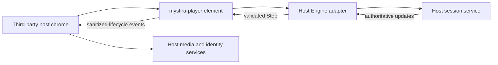

# Design: Third-Party Scenario Embedding

## Boundary

The shared player is a scene renderer and action surface. A host engine is the authority for content selection, role permissions, turn order, vote tally, deadlines, branching, persistence and synchronization. Spec 6 extends the public integration contract; it does not fork the renderer or make the player a multiplayer server. Spec 5's Blazor adapter is one host adapter, not the portable contract itself.

## Runtime contract extensions

Keep `startSession`, `resumeSession` and `respond`. Add a documented optional session-update subscription on the host engine, with unsubscribe/abort on unmount. A host without push may refresh via `resumeSession`; the element does not open its own socket or choose a transport. The adapter validates every pushed `Step`, orders updates by an engine-issued monotonically comparable revision, and ignores older revisions. The current `version: string` remains an opaque concurrency token unless a separate ordered revision is provided.

A step supplies a public session mode (`solo`, `turn`, `facilitated`, `vote`), safe participant presentation, the current participant's permissions, and optional aggregate status. A group-vote step may show submitted/required counts and a host-supplied deadline, but never another participant's private choice. The host decides quorum, tie handling and timeout. The player shows waiting, voting and resolved states without embedding those decisions in its renderer. Participant identity for submission is host-issued and passed to the engine through its adapter; lifecycle events omit it.

`respond` retains `answerRequestId`, `version` and `nodeId`. A conflict returns the current step and clears local pending UI; an accepted action may return a waiting step on the same node. A push may then deliver the resolved next step. Remount calls `resumeSession` before accepting new actions. Roll support from Spec 5 is an optional capability rather than a prerequisite for every third-party host.

## Content and extensions

The portable format is the versioned runtime `Node`/`Step` schema. Hosts may adapt JSON, a CMS, a learning system or Mystira YAML into it. Published samples use fictional content and a plain-HTML host; no Mystira account or private API is required. Capability negotiation advertises supported interaction and scene-stage extension names/versions. An unsupported required capability produces an error state and event without advancing the session. A host-provided interaction extension receives a validated data descriptor and can emit only a typed action to `Engine.respond`; a scene-stage extension receives presentation data and a bounded mount target. Authored content cannot inject executable code.

The host resolves signed/protected media URLs and declares channel ownership for narration, music and effects. The player handles only its owned media lifecycle. Host time is authoritative for synchronized clips and deadlines; client countdowns are display aids. Captions/transcripts, focus, keyboard controls and reduced motion are part of each sample's acceptance.

## Delivery slices and proof

1. **Portable solo/turn host:** plain HTML sample with a local engine adapter, two named seats, role-gated actions and remount recovery. This proves package independence from Mystira services.
2. **Shared session host:** second framework sample with two browser clients, host-driven updates, a vote scene, conflict handling and reconnect. Use a deterministic in-memory service fixture for contract tests; production transport belongs to the host.
3. **Media/extension host:** one sample scene with video/captions and a bounded host stage extension, including cleanup and missing-capability fallback.

Publish an integration guide, schema/version policy, package exports and examples. Run contract tests against the two adapters and a real multi-client browser harness. Do not claim third-party multiplayer readiness from a single-tab demo. Scope, package licensing and asset rights must be clear in the published docs.
