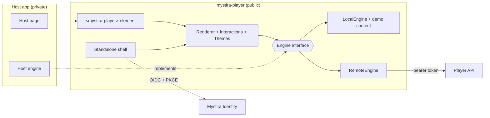

# Mystira Player: Technical Specification

| | |
|---|---|
| Status | v1.5, final, issued to the team for build start |
| Date | 24 November 2026 |
| Companion docs | [PRD](./prd.md) v0.8, [Content format](./content-format.md) v1.1 |
| Changes from v1.4 | Status only, plus the validated content artefacts: `content/manor/pumpkin-gate.story.yaml` (full example), `schema/story-schema-2.1.json` (player view) and `scripts/check-content.py`. Rechecked against Mystira `dev` at `1678d11` (24 Nov): no change to the story schema or parser. |
| Changes from v1.3 | Content is now Mystira's own story YAML (schema version 2.1, backwards compatible) instead of a player-only format: tap targets are the existing scene objects plus branches, lessons are a `lesson` block in the same file, and demo-only selection moved to a `demo` block. The runtime node model (sections 5 and 6) is unchanged; section 7 now describes how `LocalEngine` compiles story YAML into nodes. v1.3 added the four-type interaction cap, the three modes and the check, research and validation rules. |

> Public document. It specifies the player, its embedding contract and the API contract it needs. It does not describe how any engine makes its decisions.

## 1. Summary

The player renders **nodes** handed to it by an **engine**: stories, lessons and checks are all sequences of nodes. A node is a scene (picture or video, characters, dialogue, overlays) plus at most one **interaction**. It ships in two forms built from one source:

- **Standalone app:** a static SPA (React, TypeScript, Vite), used for the Kiroween entry.
- **Embeddable element:** `<mystira-player>`, a custom element with its own shadow root, so any host page can mount it: a React or Next.js app, a Blazor WebAssembly app or plain HTML. A React component export is also provided.

The renderer knows nothing about which engine it talks to, about content graphs, or about how a piece was chosen for a child. Engines implement one interface:

| Engine | Lives in | Used by |
|---|---|---|
| `LocalEngine` | this repo | the Kiroween demo, development, tests, anyone running the repo from a fresh clone |
| `RemoteEngine` | this repo | the standalone app, against the player API (section 9) |
| Host-provided engines | the host app | a host that already owns content or session logic passes its own engine object in (section 12) |



## 2. Decisions

| Decision | Choice | Trade-off / alternative |
|---|---|---|
| Framework | React 19 + TypeScript (strict) + Vite | Matches Mystira's React apps. React is bundled inside the element build, so non-React hosts need nothing extra. |
| Embedding | Custom element with shadow DOM, plus a React component export | Shadow DOM isolates styles both ways; theme tokens are CSS custom properties, which cross the shadow boundary. An iframe was rejected for audio autoplay, focus and sizing friction. |
| Routing | Standalone: TanStack Router. Embedded: in-memory state only | An embedded player must never touch the host's URL or history. |
| Data fetching | TanStack Query inside `RemoteEngine` only | The renderer stays engine-agnostic. |
| Validation | Zod schemas for every node, interaction and the YAML format | Types inferred from schemas; invalid content fails loudly in tests and in a Kiro hook. |
| Interaction scope | Four core types; three stretch types behind `interactions.enabled` | Each type is real work; the owner's cap is three or four. Story length and the number of demo children cost little by comparison. |
| Auth | Standalone: OIDC authorisation code + PKCE (`oidc-client-ts`) against Mystira Identity, as a public client restricted to adult accounts. Embedded: none | Nothing in the bundle or config is secret. Children never sign in. |
| Narration | Recorded audio when provided; otherwise the Web Speech API (`speechSynthesis`) with per-speaker pitch and rate | The repo runs and speaks with no audio licensing. Recorded audio remains the production path. |
| Sound | Web Audio API, generated tones for feedback only (and the pattern pads, if built) | No audio files needed for interaction sounds. |
| Music | Hint to the host by default (`music="host"`), or played by the player (`music="self"`) | Hosts with an existing music system keep it. |
| Styling | CSS custom properties (tokens) + CSS Modules, injected into the shadow root | No CSS-in-JS runtime. |
| Bundle | Vite library mode: `mystira-player.js` (ES module, React included) and `react.js` (React as a peer) | Budget: element build under 140 kB gzipped, excluding media. |
| Hosting (standalone) | Azure Static Web Apps | Cheap and easy to keep live until 29 January 2027. |
| Licence | Apache-2.0 for code (decided 24 Nov); `content/` all rights reserved, see NOTICE | Apache adds a patent grant, a trademark clause and a NOTICE file over MIT. |

## 3. Identity and audience

### Identifiers

| Term | Meaning | Lifetime |
|---|---|---|
| `accountId` | The signed-in grown-up's account. Never sent by the player; the API derives it from the token. | Account |
| `profileId` | A child's persistent profile on the account. The picker shows profiles; pending checks and results belong to a profile. | Persistent |
| `playerId` | A participant seat in one session: a `Profile` player (has a `profileId`) or a `Guest` player (display name only). Every answer is attributed to a `playerId`. | One session |
| `sessionId` | One play-through of one activity. | One session |

Rules:

- The picker lists profiles, not players. Starting a session turns selected profiles (and any guests) into players.
- Lessons and checks require exactly one `Profile` player. Guests can play story content but not checks.
- Anonymous content runs with no players; `playerId` is then omitted.
- Payloads carry a player's `displayName` and avatar only. No dates of birth, other profile fields or record data reach the player.
- **Rationale is the one exception.** A node's `rationale` may describe the child in plain words ("Daan likes explaining to others"). It is meant for the grown-up, so the notes panel shows only in demo mode or to the signed-in grown-up, never to a child playing alone and never in an embedded player unless the host turns it on.

### Sign-in

Mystira Identity is an OIDC provider. The standalone player registers as its own **public client with PKCE**, permitted **adult accounts only**: the grown-up signs in and chooses a child's profile. Embedded, the player performs no sign-in.

### Age groups

Content declares its target age group, using the platform's string ids: `1-2`, `3-5`, `6-9`, `10-12`, `13-18`, `19+`. The engine sends it on every `Step`; the player uses it only for presentation defaults (section 11). The Kiroween content targets `6-9`.

## 4. Repository layout

```
mystira-player/
  .kiro/              steering/, specs/ (generated in Kiro), hooks/
  docs/               prd.md, tech-spec.md, content-format.md, kiro-writeup.md
  public/config.json  runtime config per environment (not secret)
  content/manor/      hub.yaml, pumpkin-gate.story.yaml, assets/   (see content-format.md)
  schema/             story-schema-2.1.json (player view of Mystira's story schema, plus the 2.1 additions)
  scripts/            check-content.py (schema plus content-format section 10 rules; used by the hook and CI)
  src/
    app/              standalone shell: routes, providers, auth, demo controls
    element/          <mystira-player> definition, attribute/property/event wiring
    engine/           types.ts, local/, remote/
    schema/           node.ts, interactions.ts, story-yaml.ts (Zod, mirrors schema/story-schema-2.1.json)
    player/           Player root, Hub, SceneView, MediaStage, Dialogue, Characters,
                      Overlay, NotesPanel, EndView, ErrorView
    interactions/     Choices, Hotspots, Sequence, Inspect, shared/ (modes, feedback ladder)
    interactions/stretch/  Pattern, Keypad, Count (built only if time allows)
    voice/            NarrationPlayer (recorded), SpeechVoice (speechSynthesis), Tones (Web Audio)
    theme/            tokens, density, themes/manor, themes/mystira-{light,dark,bright}
  tests/e2e/          Playwright (standalone and element harness)
  LICENSE, NOTICE, README.md
```

## 5. Engine interface

```ts
// src/engine/types.ts
export interface Engine {
  listProfiles?(): Promise<Profile[]>;           // optional: anonymous engines have none
  getHome?(profileId: string): Promise<Home>;    // optional

  startSession(req: StartSessionRequest): Promise<Step>;
  resumeSession(sessionId: string): Promise<Step>;
  respond(sessionId: string, r: AnswerSubmission): Promise<Step>;
}

export type Profile = { profileId: string; displayName: string; avatarUrl?: string };

export type Home = {
  activities: ActivityCard[];
  hub?: Hub;                   // optional themed home; otherwise cards grouped by kind
};

export type ActivityCard = {
  activityId: string;
  kind: "story" | "lesson" | "check";
  title: string;
  imageUrl: string;
  ageGroupId: AgeGroupId;
  state: "locked" | "open" | "solved";
  pending: boolean;            // a check is waiting; server-owned
  resumeSessionId?: string;
  narration?: Narration;
};

export type Hub = {
  background: { imageUrl: string; alt: string };
  narration?: Narration;
  doors: { activityId: string; region: Region; label: string }[];  // tap regions on the background
  keys?: { activityId: string; label: string; iconUrl: string }[]; // earned keys, shown on the ring
};

export type AgeGroupId = "1-2" | "3-5" | "6-9" | "10-12" | "13-18" | "19+";

export type PlayerSeat =
  | { type: "Profile"; profileId: string }
  | { type: "Guest"; displayName: string };

export type StartSessionRequest = {
  activityId: string;
  players: PlayerSeat[];
  startNodeId?: string;        // deep-link entry; honoured only if the engine allows it
};

export type SessionPlayer = {
  playerId: string;
  type: "Profile" | "Guest";
  profileId?: string;
  displayName: string;
  avatarUrl?: string;
};

export type Answer =
  | { kind: "continue" }
  | { kind: "back" }
  | { kind: "choice"; choiceId: string }
  | { kind: "hotspot"; hotspotId: string }
  | { kind: "sequence"; itemIds: string[] }      // the full order, submitted on Done
  | { kind: "inspect"; partIds: string[] }       // the parts the child marked
  // stretch, only when the type is enabled:
  | { kind: "pattern"; stepIds: string[] }
  | { kind: "keypad"; value: string }
  | { kind: "count"; targetIds: string[] };

export type AnswerSubmission = {
  answerRequestId: string;     // UUID; idempotency key
  version: string;             // session version the answer was given against
  nodeId: string;
  answer: Answer;
  wrongTries?: number;         // practice mode only: wrong tries before this answer
  playerId?: string;           // required whenever the session has players
};

export type Step = {
  sessionId: string;
  version: string;
  ageGroupId: AgeGroupId;
  players: SessionPlayer[];
  activePlayerId?: string;
  node: Node;
  canGoBack?: boolean;         // the engine accepts { kind: "back" } on this node
  progress?: { done: number; total: number };
  prefetch?: string[];
};
```

Engine rules (`LocalEngine` and the player API both follow them):

- `respond` is idempotent on `answerRequestId`: a replay returns the same `Step`.
- A stale `version` fails with `EngineError` kind `conflict` carrying the current `Step`; the player renders it.
- A `Step` carries only what is needed to render the current node: never the graph, other children's versions, or check answers.
- `{ kind: "back" }` is accepted only where `canGoBack` is true. `canGoBack` is always false on `check` nodes.
- A `check` with `attempt: 2` is never scored.
- In practice mode the player judges each try locally and submits only the final, correct answer, with `wrongTries`. After `revealAfter` wrong tries (default 3) the player shows where the answer is and the child still makes the final tap, so no child gets stuck and the engine never has to rescue a practice piece.
- Errors are `EngineError` with kind `network`, `auth`, `notFound`, `conflict`, `unsupported` or `server`.

## 6. Node schema

### Shared parts

```ts
type Region =                                   // all values 0..1 of the scene box
  | { shape: "rect"; x: number; y: number; w: number; h: number }
  | { shape: "circle"; x: number; y: number; r: number };

type Speaker = { id: string; name: string; avatarUrl?: string; colour: string;
                 voice?: { pitch: number; rate: number } };   // speech-synthesis hints

type Line = { speakerId: string | "narrator"; text: string; audioUrl?: string;
              wordTimings?: { word: string; startMs: number; endMs: number }[] };

type Narration = { text: string; audioUrl?: string;
                   wordTimings?: { word: string; startMs: number; endMs: number }[] };

type Media = {
  imageUrl?: string;
  alt?: string;                                 // empty for decorative images
  video?: { url: string; posterUrl?: string; onEnd: "advance" | "stop"; skippable: boolean };
};

type Overlay = { id: string; text: string; anchor: { x: number; y: number };
                 align: "start" | "center" | "end"; style: "caption" | "callout" | "label";
                 maxWidth?: number; narration?: Narration };

type Rationale = { differs: boolean; text: string };   // notes panel; written by the engine (section 3)

type SceneBase = {
  id: string;
  title?: string;                               // step name in the notes panel
  media: Media;
  characters: { id: string; imageUrl: string; alt: string;
                position: "left" | "center" | "right"; pose?: string;
                reactions?: ("jump" | "startle" | "wave")[] }[];   // max 3
  speakers: Speaker[];
  lines: Line[];                                // dialogue, played in order
  task?: Narration;                             // the instruction for the interaction; not on checks
  overlays: Overlay[];
  music?: { profile: string };
  exitAllowed?: boolean;
  rationale?: Rationale;
  slot?: string;                                // shadow-DOM slot the host can fill on this node
};
```

### Interaction modes

Every interaction runs in one of three modes, decided by the node, not by the type:

| Mode | When | Who judges | Feedback |
|---|---|---|---|
| **open** | a `scene` whose interaction has no `local` block | nobody; any answer is accepted | none |
| **practice** | a `scene` whose interaction has a `local` block | the player, from `local` | per try, by the ladder below |
| **check** | a `check` node | the engine, after submission | none before the first answer |

Practice feedback ladder: wrong try *n* plays `onWrong[n-1]` if present, else `hint`, else the built-in "Not yet. Try again." It comes with a gentle shake and a low tone, never a red cross or a failure sound. After `revealAfter` wrong tries the correct target pulses, and the child still taps it.

### Core interactions

```ts
type Feedback = { hint: Narration; onWrong?: Narration[]; revealAfter?: number };   // default 3

type PartRole = "sender" | "heading" | "text" | "link" | "button" | "image" | "price" | "footer";

type Interaction =
  | { type: "continue"; label?: string }
  | { type: "choices";
      options: { id: string; label: string; imageUrl?: string; alt?: string;
                 icon?: "next" | "retry" | "look" }[];                  // 2 to 4
      local?: { correctId: string; feedback?: Feedback } }
  | { type: "hotspots";
      spots: { id: string; region: Region; label: string;
               reveal?: { text: string; imageUrl?: string; alt?: string } }[];   // 2 to 6
      local?: { correctId: string; feedback?: Feedback } }
  | { type: "sequence";
      items: { id: string; label: string; imageUrl?: string; alt?: string }[];  // 3 to 5, already shuffled by the engine
      local?: { order: string[]; feedback?: Feedback } }
  | { type: "inspect";
      document: { kind: "message" | "page" | "sign"; title: string;
                  parts: { id: string; role: PartRole; text: string;
                           imageUrl?: string; alt?: string }[] };         // 3 to 8
      minMarks?: number;                                                  // default 1; 0 allows "nothing is wrong"
      local?: { flagged: string[]; feedback?: Feedback } };
```

Rules:

- `continue` and `back` are navigation, not interaction types, and do not count toward the cap.
- **Hotspot** regions are invisible: finding them is the task. Each hit area is padded to the density minimum (48 px at `6-9`). A tap on no spot shows "Nothing here" and does not count as a wrong try. `reveal` is not allowed on check nodes.
- **Sequence** never auto-submits. The child places items, can Undo, and taps Done (or "That's my answer" on a check). The engine shuffles; the player never reorders.
- **Inspect** content uses invented names, brands and domains only (`*.example`).
- **Check nodes** never carry `local`, `task` or `reveal`; the schema rejects them.

### Stretch interactions

Built only if time allows, in this order. `config.json` `interactions.enabled` lists the types the build supports; content using any other type raises `unsupported`, and the content hook warns rather than fails.

```ts
  | { type: "pattern"; steps: { id: string; label: string; icon?: string; tone: number }[];  // 3 to 4 pads
      demo: string[];                                   // 3 to 5 step ids; the demo is the answer
      feedback?: Feedback }                             // practice only; never on check nodes
  | { type: "keypad"; maxLength: number; reference?: string; showCall?: boolean;
      local?: { value: string; feedback?: Feedback } }  // digits only; "Call" is pretend, no tel: link; no reference on checks
  | { type: "count"; targets: { id: string; region: Region; label: string }[];   // 2 to 8 spots on the scene
      local?: { found: string[]; feedback?: Feedback } } // running tally; finds every one in the picture
```

`pattern` works muted: every pad lights and is labelled, and the demo can always be replayed.

### Node types

```ts
type Node =
  | ({ type: "scene"; interaction: Interaction } & SceneBase)
  | ({ type: "check"; question: Narration; interaction: Interaction;
       attempt: 1 | 2; scored: boolean } & Omit<SceneBase, "task">)   // attempt 2 implies scored: false
  | ({ type: "research"; step: "where" | "find" | "verify" | "use";
       source?: { kind: "character" | "picture" | "clip" | "chart" | "page"; label: string };
       yourAnswer?: string; interaction: Interaction } & SceneBase)
  | ({ type: "result"; correctFirstTry: number; total: number;
       key?: { label: string; iconUrl: string }; interaction: Interaction } & SceneBase);
```

Notes:

- A `check` with `attempt: 1` shows "Only the first try counts" and asks the child to select, then tap **"That's my answer"**, so an accidental tap never costs the score. After a wrong first answer the engine returns `research` nodes, then the same question as `attempt: 2, scored: false`, shown as "This try does not count for the score".
- `research.yourAnswer` lets the player show the child's first answer next to what they found.
- `slot` names a shadow-DOM slot the host can fill on that node, for example a sign-up call to action on a story's final scene or a check's result.
- A node or interaction type the player does not know, or one not in `interactions.enabled`, raises `unsupported`; the element emits `mp-unsupported-node`.
- Story content (a scene with a list of choices leading to other scenes, or a single next scene, ending in an ending scene) maps onto `scene` nodes with `choices` in open mode, or `continue`. `check`, `research` and `result` are used by lessons only.
- Asset URLs are absolute (remote, hosted) or relative to the content folder (local). Remote media URLs are stable and long-cached, so `prefetch` is safe.

## 7. Content and how it becomes nodes

Content is Mystira's own story YAML, schema version `2.1`. The format, with a worked example, is in [content-format.md](./content-format.md); this section covers only how an engine turns it into the nodes of section 6.

**Schema.** The repository carries `schema/story-schema-2.1.json`: the player's view of Mystira's story schema. It accepts every field of the full schema, so any Mystira story validates, but describes in detail only the fields the player uses and the `2.1` additions. Engine-only fields are accepted as opaque objects.

**Compilation** (done by `LocalEngine`; a remote engine does the same on the server):

| Story YAML | Node |
|---|---|
| scene, `type: narrative`, `next_scene` set, no `interaction` | `scene` + `continue` |
| scene, `type: choice`, branches without `object_id` | `scene` + `choices` (one option per branch) |
| scene, `type: choice`, branches with `object_id` | `scene` + `hotspots` (one spot per object with a 2D `geometry.bounds`) |
| scene with `interaction.kind: sequence` or `inspect` | `scene` + `sequence` or `inspect` |
| scene with `practice` | the same interaction with a `local` block built from `practice` |
| a question scene in `lesson.checks` | `check` node, `attempt: 1`; the answer stays in the engine |
| a scene with `research` | `research` node |
| `lesson.result` | `result` node |
| `description` (no `lines`) | one narrator line |
| `lines`, `task`, `cast`, `overlays` | `lines`, `task`, `characters`, `overlays` |
| `media.image` / `audio` / `video`, `narration_timestamps` | `media`, line audio, `wordTimings` |
| `music.profile` | `music.profile` hint |
| `type: roll` or `special`, or `stage3d` only | `unsupported` (host handles it) |

`LocalEngine` picks each piece's version and the piece order from the `demo` block, takes rationales from it, shuffles sequence items, strips every `answer` before building a node, and computes door state and pending checks from local progress.

**Validation** runs as a Kiro hook and in CI: schema, references, check-scene rules, box bounds and overlap, interaction limits, enabled interaction types (warning only) and demo profile fields, as listed in content-format.md section 10.

## 8. Demo controls

Demo controls exist only when `config.json` sets `mode: "local"` and `demo: true`:

- **Child switch:** jumps to the same piece for the other demo child, so the two versions can be compared directly.
- **Day switch:** lesson, Day 3 check, Day 5 check.
- **Notes toggle:** opens the notes panel.

They are rendered by the standalone shell, outside the player root, so they never appear in an embedded player.

## 9. Player API contract (proposed)

For `RemoteEngine`. Versioned under `/v1/player`; bearer token from Mystira Identity with a player-specific audience and scope; every `profileId` and `sessionId` is authorised against the token's account.

| Method | Path | Body | Returns |
|---|---|---|---|
| GET | `/v1/player/profiles` | | `Profile[]` |
| GET | `/v1/player/home?profileId=` | | `Home` |
| POST | `/v1/player/sessions` | `StartSessionRequest` | `Step` (201; returns the open session if one exists for that activity and profile) |
| GET | `/v1/player/sessions/{sessionId}` | | `Step` |
| POST | `/v1/player/sessions/{sessionId}/answers` | `AnswerSubmission` | `Step`; `409` with the current `Step` on a stale `version` |

Errors use `application/problem+json`. CORS allows only the player's deployed origins. The API owns every rule: next node, the version of each piece for this child, order, pace, support, pending state, scoring, research steps and rationales. `AnswerSubmission` carries only what the child did.

## 10. Rendering

- **Scene box.** Fixed 16:9 logical box, letterboxed to its container with container queries. All regions and anchors are relative to the box.
- **Dialogue.** Lines play in order, each shown with its speaker's avatar, name and colour, and narrated in that speaker's voice. A replay control replays the current line; tapping a line replays it.
- **Voice.** For each line: recorded `audioUrl` if present, else `speechSynthesis` with the speaker's `pitch` and `rate`. Speech is cancelled on node change and on unmount. If neither is available, text stays on screen and nothing blocks.
- **Interactions never wait for audio.** They are usable while lines are still being spoken; a tap on an interaction stops the speech.
- **Characters.** Three named slots. With `reactions`, a tap on the character plays one of them as a short CSS animation with a tone; it never advances the node or counts as an answer, and reduced motion swaps it for a small bounce.
- **Media stage.** Image, or video with poster; `onEnd: advance` advances automatically; `skippable` shows a skip button; a video error shows a notice plus the interaction.
- **Overlays.** Positioned at `anchor`, always on a backing plate (WCAG 2.2 AA), clamped to a safe area.
- **Interactions** (each its own component with keyboard support):
  - *choices:* 2 to 4 buttons with optional pictures.
  - *hotspots:* invisible regions padded to the density minimum; focus rings and labels on keyboard focus; "Nothing here" on a miss; `reveal` shows its picture or text in place.
  - *sequence:* tap items into slots in order; Undo; Done (or "That's my answer" on a check).
  - *inspect:* the document is rendered as a mock message, page or sign; parts are drawn by role; the child marks parts, then taps Done. With `minMarks: 0` a "Nothing is wrong" button appears.
- **Checks.** The child selects, then taps "That's my answer". Show the attempt banner; disable interaction while a submission is in flight; reuse `answerRequestId` on retry.
- **Notes panel.** Shows the node `title`, a "same for every child" or "different for each child" tag from `rationale.differs`, and `rationale.text`. Available only in demo mode or to the signed-in grown-up (section 3). Hidden when the node has no rationale.
- **Transitions.** Cross-fade by default; decorative motion off under `prefers-reduced-motion`.

## 11. Presentation density

| Age groups | Targets | On-screen text | Narration default |
|---|---|---|---|
| `1-2`, `3-5` | min 64 px, max 4 per row | short lines, large type | on, autoplay after first gesture |
| `6-9` | min 48 px | full sentences, large type | on |
| `10-12`, `13-18`, `19+` | min 44 px | full paragraphs, standard type | off; replay available |

Narration can always be toggled; the toggle lasts for the session.

## 12. Embedding contract

### Element

```html
<mystira-player
  theme="mystira-dark"         <!-- manor | mystira-light | mystira-dark | mystira-bright -->
  music="host"                 <!-- host | self -->
  locale="en"                  <!-- UI chrome only; content text arrives in the content's own language -->
  notes="off"                  <!-- on | off: the host decides whether the notes panel exists -->
  data-testid="player">
  <div slot="end-cta">...host content...</div>
</mystira-player>
```

| Property / method | Purpose |
|---|---|
| `engine: Engine` | Required. The host assigns an engine object. |
| `start(req: StartSessionRequest)` | Begin a session; call from, or after, a user gesture. |
| `resume(sessionId)` | Resume a session. |
| `muted: boolean` | Mutes narration and tones (and music when `music="self"`). |

Events (`CustomEvent`, `bubbles` and `composed`):

| Event | `detail` |
|---|---|
| `mp-ready` | `{}` |
| `mp-node-enter` | `{ sessionId, nodeId, nodeType, music?, exitAllowed }` |
| `mp-answer` | `{ sessionId, nodeId, answerKind, playerId? }` (no answer values) |
| `mp-complete` | `{ sessionId }` |
| `mp-unsupported-node` | `{ sessionId, nodeId, rawType }` |
| `mp-error` | `{ kind, retryable }` |

### Host obligations

- Provide the engine (and with it auth, telemetry and persistence).
- Own the page chrome: headers, exit controls, navigation locks; use `exitAllowed`.
- Own background music when `music="host"`.
- Own any story state the child sees (scores, awards, progress rails); the player has no place for it.
- Keep `theme` in step with the host's light, dark or bright mode.
- Size the element; the player fills its box.

### Guarantees to hosts

- No global CSS, no global listeners beyond its own element, no URL or history changes, no storage outside `sessionStorage` keys prefixed `mp:`.
- Safe to mount, unmount and remount; unmount stops all audio, speech and video and aborts in-flight requests.
- No network requests of its own when embedded: every request goes through the host's engine.
- Theme tokens are documented CSS custom properties (`--mp-*`).

## 13. Theming

- Tokens: colour, typography, radius, spacing, glow, motion durations, density, speaker defaults, decorative layers, door and key art, indicator style.
- A theme is a token set under `:host([theme=...])` plus optional ambient decorations behind the scene box.
- `manor`: deep plum and candle-orange, warm glows, rounded display font, drifting dust and friendly ghosts, door plaques; nothing threatening, no sudden motion.
- `mystira-light`, `mystira-dark`, `mystira-bright`: neutral themes matching the platform's three display modes, intended to be overridden by host design tokens.
- Contrast is checked for every token pair in a unit test.

## 14. Kiro usage

| Kiro feature | Use |
|---|---|
| Steering | `product.md` (PRD), `tech.md` (section 2), `structure.md` (section 4), `content.md` (from content-format.md: Mystira story YAML 2.1, no real children's data, invented names and `*.example` domains only). |
| Specs | Generated in Kiro from these docs, four in all: the core (schema, engine, renderer, modes and feedback ladder), choices and hotspots, sequence, and inspect. A stretch type gets its own spec only if it is started. Implemented task by task. |
| Hooks | `src/schema/**` saved: check it still matches `schema/story-schema-2.1.json`, run schema tests. `content/**/*.yaml` saved: run content validation (section 7), and warn on any interaction type not in `interactions.enabled`. `src/theme/**` saved: contrast and density tests. `src/interactions/**` saved: that interaction's tests. |
| Write-up | `docs/kiro-writeup.md`. |

## 15. Testing

| Level | Tool | Covers |
|---|---|---|
| Unit | Vitest | Schemas (no `local`, `task` or `reveal` on checks; attempt 2 never scored), content validation (door references, region bounds and overlap), `LocalEngine` transitions, per-child versions, check answers stripped from steps, sequence shuffling, `revealAfter`, idempotency and version conflicts, region maths, density, contrast. |
| Component | Vitest + Testing Library | Each core interaction in open, practice and check mode; the feedback ladder and reveal; "Nothing here" on a hotspot miss; "That's my answer"; Undo and Done; inspect with `minMarks: 0`; keyboard operation; dialogue with speech mocked and stopped by a tap; research flow; notes panel visibility rules; error screens. |
| Contract | Vitest + MSW | `RemoteEngine` against recorded responses including 401, 409 and network failure. |
| Element | Playwright, plain HTML harness page | Mount, unmount, remount; events and their `detail`; slot content; no style leakage; host-assigned engine used; no network requests from the element; speech cancelled on unmount. |
| E2E | Playwright | Local demo: hub, Pumpkin Gate for both children (including the inspect piece), Day 3 check with a deliberate wrong answer, research, unscored retry, result and key. Axe on each node and interaction type. |

## 16. CI/CD

GitHub Actions, one workflow, path-filtered, concurrency cancels superseded runs: lint, typecheck, content validation, test, build (app and element), element and E2E tests on pull requests; on `main`, deploy the standalone app; on tagged releases, publish the element build. Credentials are repository secrets.

## 17. Security and privacy

- No secrets in the repository, bundle or `config.json`.
- No real children's data: demo children are invented, and content validation rejects demo profile fields other than those in content-format.md section 8.
- Standalone CSP: `default-src 'self'`; `connect-src` the API and Identity; `img-src` and `media-src` limited to `assetOrigins`; no inline scripts; no third-party scripts.
- Embedded: no requests of its own (section 12).
- Rationale text reaches only the grown-up (section 3).
- Speech synthesis runs in the browser; whether it uses an online voice depends on the browser and operating system. Only content text is passed to it.
- `mp-answer` events carry the kind of answer, never its value.
- The keypad, if built, never dials: "Call" is pretend.

## 18. Risks

| Risk | Mitigation |
|---|---|
| Four interaction types are still too much for the time | Inspect is the first core type to cut (the "what do they want" piece falls back to choices); stretch types are not started unless the core is done. |
| Speech voices differ by browser and some sound poor | Per-speaker pitch and rate; recorded audio for the main characters if time allows; text always on screen. |
| Player API not ready | The demo runs on `LocalEngine` only; signed-in mode is cut first. |
| Host CSS or scripts interfere with the element | Shadow DOM, element harness tests, documented token surface. |
| Autoplay blocks audio or video | Start from a user gesture. |
| Bundle too heavy for a WebAssembly host | Size budget in CI; lazy-load interactions and video. |

## 19. Open decisions

1. Static Web Apps or Blob + Front Door for the standalone app (default: Static Web Apps).
2. Turn-taking UI for several players (default: `activePlayerId` badge only).
3. Element registration: self-registering on import, or an exported `define()` (default: `define()`).
